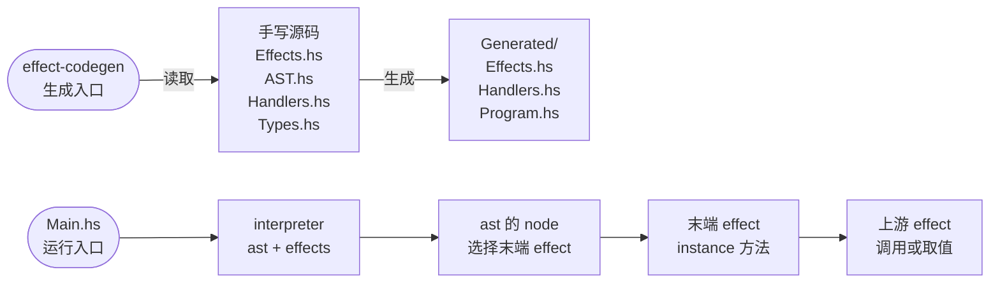

# Algebraic Effect Sys in Haskell

一个实验性的 Haskell effect SDK。业务程序分成两部分来写：

- **组合关系用声明描述**：有哪些操作、谁依赖谁、需要哪些值、按什么顺序执行。这部分是固定结构，可以序列化，便于工具（例如未来的语言服务）读取和生成。
- **具体业务用原生 Haskell 实现**：普通的 `data`、`instance` 和 `do`，GHC／HLS 可以直接检查。

SDK 根据声明生成类型类接口和调用包装，负责取值、资源开关和失败处理；你只写声明和方法体。

> 项目处于接口探索阶段，可以运行但接口仍可能变化，暂不提供独立的 Cabal library。

## 快速开始

需要 **GHC 9.12.x**（代码生成器依赖该版本的解析器 API，本地与 CI 使用 9.12.2）和 **Cabal**（已验证 3.16）。可通过 [GHCup](https://www.haskell.org/ghcup/) 安装，确保 `ghc`、`ghci`、`runghc`、`cabal` 在 PATH 中。

```sh
git clone https://github.com/cartesianc/algebraic-effect-sys-in-haskell.git
cd algebraic-effect-sys-in-haskell
cabal update
cabal build all
```

运行纯计算示例（读取 20，加一，生成文本）：

```sh
cabal exec -- runghc -idemo -isdk demo/RequestBenchmark/Main.hs
```

```text
Succ (RenderedValue "number: 21")
```

运行带文件资源的示例，它会打开、读取、追加写入 `demo/FileDemo/output.txt`，结束时由 SDK 自动关闭文件：

```sh
cabal run file-demo
```

仓库已包含各示例生成好的代码，首次运行不需要先生成。所有命令都在仓库根目录执行。

## 一个程序由什么组成



两个入口：

- **生成入口 `effect-codegen`**：读取手写源码，检查组合关系和取值规则，生成 `Generated/`：类型类接口与契约类型（`Effects.hs`）、加上协议包装的方法实现副本（`Handlers.hs`）、运行入口与调用结构（`Program.hs`）。修改任何手写源码后都要重新生成。
- **运行入口 `Main.hs`**：写成 `main = interpreter ast effects`。`interpreter` 来自 `Generated/Program.hs`，它按 `ast` 编排执行：每个 node 选择一个末端 effect，运行它的 instance 方法；方法体里显式调用上游 effect，或用 `request` / `require` 取值，整条操作链由此展开。

| 你写的文件 | 内容 |
| --- | --- |
| `Types.hs` | 业务数据类型，普通 `data`／`newtype` |
| `Effects.hs` | effect 注册：类别、方法名、能力继承、需要哪些值 |
| `Handlers.hs` | 每个 effect 的 `instance`，写计算、模式匹配和 IO |
| `AST.hs`、`Workflow/*.hs` | 哪些操作链按什么顺序或并行执行 |
| `Main.hs` | 一行：`main = interpreter ast effects` |

`Generated/` 由生成器产出，不要手改。运行时编译的是 `Generated/Handlers.hs`，即你的方法体加上 SDK 的协议包装。

## 写一个 effect：以纯计算示例为例

完整代码见 [demo/RequestBenchmark](demo/RequestBenchmark)。

**1. 准备表示类型**（[Types.hs](demo/RequestBenchmark/Types.hs)）

Types.hs 只放值的结构。这个示例里数字直接用 `Int`，不需要专门定义类型；契约类型由生成器产出（见下一步）。

**2. 注册 effect**（[Effects.hs](demo/RequestBenchmark/Effects.hs)）

```haskell
EffectSpec
  { name = "AddOne"
  , typing = Context { request = requester "addedValue" @Int, require = Just "readAddedValue" }
  , input = "Root"
  , demands = [requests "NumberValue"]
  }
```

这条注册的意思是：`AddOne` 是一个 Context，生产方法叫 `addedValue`。生成器按 handler 名产出它的契约类型 `newtype AddedValue = AddedValue Int`，契约名就是 handler 名首字母大写。它需要契约 `NumberValue`，也就是 handler 名为 `numberValue` 的那个 Context（这里是 `MakeNumber`），生成器会自动接上。

**3. 生成接口**

```sh
cabal run effect-codegen -- target RequestBenchmark
```

生成器在 `Generated/Effects.hs` 中产出 `AddOneEffect` 类型类和契约类型 `AddedValue`，方法 `addedValue :: m AddedValue` 已声明好。

**4. 实现方法**（[Handlers.hs](demo/RequestBenchmark/Handlers.hs)）

```haskell
instance MakeNumberEffect Pure where
  numberValue = do
    DemoInputs (InputSettings (Start number) _) <- request @DemoInputs
    if number < 0
      then raise (MakeNumberError ("Invalid start: " ++ show number))
      else pure (NumberValue number)
```

`request @DemoInputs` 取得所需的值，`raise` 报告失败，`NumberValue number` 构造本 Context 的产出。写完再运行一次生成命令，就可以执行了。

## 核心概念

### 五类 effect

| 类别 | 用途 | 方法返回 |
| --- | --- | --- |
| `Context` | 生产或读取在操作之间传递的业务值 | 业务类型 |
| `Pure` | 不产出业务值的纯检查 | `()` |
| `Excu` | 不产出业务值的执行操作 | `()` |
| `Scoped` | 资源的开启（`open`）与关闭（`close`） | `()` |
| `Error` | 对指定类型的失败做诊断和处置 | `()` |

除 Context 外，操作只表示"完成"或"失败"；需要在操作之间传递的值一律由 Context 产出。

### 能力继承：`input`

`input = "FileSession"` 表示这个 effect 的实现可以调用 `FileSession` 的方法（以及它继承来的方法），在 Haskell 里体现为 superclass。继承只提供"可以调用"的能力，不会自动执行任何东西：上游操作只在你的方法体里显式调用时才会运行。

### 取值：`request` 与 `require`

每个 Context 用 `requester "handler名" @表示类型` 声明生产方法，生成器按 handler 名产出它的契约类型：

```haskell
-- 生产方：契约名 StartURL 来自 handler 名 startURL
typing = Context { request = requester "startURL" @PageURL, require = Just "readStartURL" }
-- 生成：newtype StartURL = StartURL PageURL
```

消费方在 `demands` 里用契约名声明需要的值，在方法体里用同名的调用取得：

| 注册中 | 方法体中 | 含义 |
| --- | --- | --- |
| `requests "StartURL"` | `x <- request @StartURL` | 重新生产一次，并把结果保存为当前绑定 |
| `requires "StartURL"` | `x <- require @StartURL` | 读取已有绑定，不重新生产；尚未生产过则失败 |

从调用点就能看出是否会重跑生产链。

**值从哪里来由契约名决定**：契约名就是生产方 handler 名首字母大写，而方法名不能重复，所以每个契约恰好有一个生产方，生成器自动接上。同一种数据有不同含义时，交给不同的 handler 产出即可。例如 [Crawler](demo/Crawler/Effects.hs) 的起始页和链接页 URL 都是 `PageURL`，分别由 `startURL` 和 `linkedURL` 产出 `StartURL` 和 `LinkedURL` 两种契约，类型上不能混用。

因此 **handler 名同时决定契约名**，要按业务含义起名（`startURL`，而不是 `loadStartURL`），也不能和 effect 名或 Types.hs 里的类型重名。契约在 Effects.hs 中看不到，所以消费方用名字字符串引用；Handlers.hs 能看到生成的类型，照常写 `request @StartURL`。

### 资源：`Scoped`

资源的开启和关闭写在同一个 instance 里。资源本身（例如文件句柄）作为 Context 的值保存，`open` 通过 `request` 取得它，`close` 通过 `require` 读回它（节选自 [FileDemo](demo/FileDemo/Handlers.hs)）：

```haskell
instance FileSessionEffect App where
  openFileSession = do
    _ <- request @OpenedFile
    pure ()

  closeFileSession = do
    OpenedFile (FileHandle path file) <- require @OpenedFile
    liftIO (hClose file)
```

你不需要自己安排关闭：一条操作链结束（包括出错）后，SDK 会关闭这条链开启过、且没有其他链仍在使用的资源；程序退出时还会再做一次兜底清理。

- **共享**：多条并行的链用相同参数开启同一类资源时，可以共享同一个实例。
- **新建**：参数是本次重新生产的（`request` 得到的），就开启新的实例。
- **显式关闭**：仍然可以手动调用 `close`；如果别的链还在用，关闭会被拒绝。

### 失败与 Error

每个 effect 自动获得一个错误类型，名字是 effect 名加 `Error`，例如 `ReadFileError "message"`，用 `raise` 抛出。失败沿调用链原样传播，记录来源和消息；程序最终返回 `Succ 结果` 或 `Failed 失败信息`。

需要对失败做处置时，注册一个 Error effect，声明它处理哪些失败：

```haskell
typing = Error
  { detect = Just "detectFileSession"
  , resolve = Just "resolveFileSession"
  , handles = [RaisedBy "ReadFile", RaisedBy "WriteFile"]
  }
```

- **`handles`**：`RaisedBy "X"` 匹配 effect `X` 用 `raise` 抛出的失败；`ScopeFaultIn`／`ContextFaultIn` 匹配资源和取值的协议错误。
- **`detect`**（可选）：进一步检查这次失败是否归它处理。
- **`resolve`**：执行处置，例如关闭资源。

处置之后，原失败仍然会继续传播，SDK 不会把失败变成成功，也不会自动重试。

### 编排：workflow

`node "名字"` 选择一条操作链的末端 effect；运行这个 node 就是调用它，它在方法体里调用的上游随之执行。用 `chained`（顺序，失败即停）和 `parallel`（并行，等待全部完成）组合，例如 [Crawler](demo/Crawler)：

```haskell
-- Workflow/ParsePages.hs
parsePages :: AST
parsePages = parallel [node "ExtractPage", node "ExtractLinkedPage"]

-- AST.hs
ast :: AST
ast = chained [parsePages, printPages]
```

- **文件组织**：每个 branch 放在 `Workflow/` 下单独的文件里，顶层只组合这些名字。
- **列表类型**：同一个列表里要么全是 node，要么全是 branch，单个 node 也要包进 `chained` 或 `parallel`。
- **节点之间**：一个 node 的结果不会自动传给下一个 node；操作之间的值传递只通过 Context。

## 开发流程

修改任何手写文件后（包括只改 `Handlers.hs` 的方法体），都要重新生成：

```sh
cabal run effect-codegen -- workflow FileDemo     # 有 workflow 的示例
cabal run effect-codegen -- target RequestBenchmark  # 纯计算示例
cabal build all
```

- **运行时检查**：运行时会核对 `Handlers.hs` 和注册是否与生成时一致，不一致就拒绝启动并提示重新生成，不会悄悄运行旧代码。
- **编辑器支持**：`Handlers.hs` 是普通 Haskell，可以在编辑器里用 HLS 检查（配置见 `hie.yaml`，HLS 需匹配 GHC 9.12.2）。它依赖的 `Generated/Effects.hs` 要先生成出来。
- **新 effect 的顺序**：先注册、生成接口，再写实现，然后再生成一次。
- **查看结构**：查看生成器推导出的调用结构和资源依赖，不执行任何业务：

```sh
cabal run crawler-demo -- --structure
```

### 生成器会检查什么

生成器不只是生成代码，还会拒绝以下写法，并给出原因：

| 情况 | 处理方式 |
| --- | --- |
| handler 名推出的契约名与 effect 名、生成区名字重名 | 换一个按业务含义起的 handler 名 |
| `demands` 里的契约名没有对应的生产方 | 检查名字：契约名 = 生产方 handler 名首字母大写 |
| 方法体里 `request @T`／`require @T` 的 `T` 没有在 `demands` 中声明 | 补上声明 |
| 直接调用其他 effect 的 Context 方法（如 `getFileName`） | 改用 `request @T`／`require @T` |
| 在生产方以外构造某个 Context 产物类型的值（例如在消费方写 `StartURL (...)`） | 值应由它的生产方产生；消费方用 `request`／`require` 取得，只做模式匹配 |
| 普通顶层函数显式使用业务类型、构造器或字段 | 把这部分操作移进注册的 instance 方法；只处理 `String` 等通用类型的 helper 可以保留 |
| 把 effect 调用藏进 helper、未知的高阶组合或循环 | 在方法体中直接调用；支持 `do`、`if`／`case`、`when`、`catchError` 等常见写法 |

这些规则保证：组合关系总能从源码中静态读出来，不会藏在任意函数里。

### 新建一个程序

1. **手写声明**：在 `demo/MyDemo/` 下写 `Types.hs`、`Effects.hs`、`AST.hs` 和 `Workflow/*.hs`。它们不能导入 `Generated` 或 `Handlers`。
2. **生成接口**：运行 `cabal run effect-codegen -- workflow MyDemo`。此时还没有 `Handlers.hs`，生成器会先产出可编译的空实现模块。
3. **写实现**：根据 `Generated/Effects.hs` 中的接口编写 `Handlers.hs`，再生成一次，并写 `Main.hs`。
4. **加入构建**：参考 [cabal 文件](algebraic-effect-sys-in-haskell.cabal) 中的 `file-demo` 增加一个 executable。

## 示例

| 示例 | 演示内容 | 运行 |
| --- | --- | --- |
| [RequestBenchmark](demo/RequestBenchmark) | 取值、纯计算链、`raise` | 见快速开始 |
| [FileDemo](demo/FileDemo) | 文件资源的开启、读写、自动关闭，Error 处置 | `cabal run file-demo` |
| [Crawler](demo/Crawler) | 并行抓取解析、顺序打印，用不同契约区分同类数据 | `cabal run crawler-demo` |
| [OpenFilesDemo](demo/OpenFilesDemo) | 一个资源持有多个文件，链结束后自动关闭与重开 | `cabal run open-files-demo` |
| [ScopeInstancesDemo](demo/ScopeInstancesDemo) | 按参数区分资源实例、复用与重开 | `cabal run scope-instances-demo` |
| [ScopeReuseDemo](demo/ScopeReuseDemo) | 并行的链共享同一个资源实例 | `cabal run scope-reuse-demo` |

Crawler 需要网络和 PATH 上的 `curl`。文件类示例的输出写在各自目录下，已加入 Git 忽略。

## 当前限制

- **未实现的能力**：事件触发的循环（loop）、middleware、通用结构适配尚未实现。
- **handler 复用**：同一段 handler 逻辑还不能服务多种数据类型，需要分别注册（Crawler 的两条链因此各有一份实现）。
- **资源清理范围**：自动清理覆盖交给 SDK 管理的资源；业务代码自己 `forkIO` 出的线程，或在 IO 中途获取、尚未交给 SDK 的资源，需要自行处理。
- **构建方式**：SDK 目前随仓库内的示例一起编译，不能作为独立依赖引入。

## 目录与进一步阅读

```text
sdk/Framework/   SDK：契约、运行时、workflow、代码生成
demo/            示例程序及其生成代码
docs/            设计文档
archive/         旧版本实现与设计（不参与构建）
```

想了解内部设计时阅读：

- [设计方法](docs/DESIGN_METHOD.md)：声明与实现的分工、取值与资源的语义。
- [最新设计](docs/LATEST_DESIGN.md)：Context、资源、生成协议的完整说明与待办。
- [结构与资源依赖](docs/EFFECT_GRAPH.md)：生成器如何推导调用结构和资源依赖。
- [源码资产检查](docs/ASSETS.md)：业务类型的使用约束。
- [开发约定](AGENTS.md)：参与开发时遵守的规则。

## License

[BSD-3-Clause](LICENSE)
