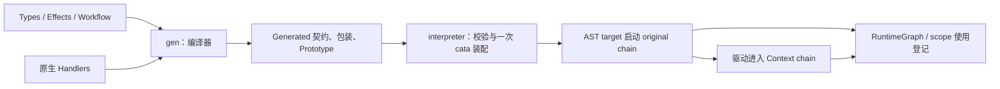

# 主设计：Algebraic Effect Sys in Haskell

项目于 2026-11-20 进入 **prebeta**。本文记录现行的业务写法、组合规则与执行协议。阶段安排与已知边界见 [Next stages](NEXT_STAGES.md#stages)。

运行和书写示例见 [GUIDE](GUIDE.md)，工作约束见 [AGENTS](../AGENTS.md)。

按任务跳转：[代码长什么样](#code-shape) · [核心对象](#model) · [设计原则](#principles) · [组合多态](#composition-polymorphism) · [代码即文档](#code-as-documentation) · [声明式设计](#declarative-design) · [句柄与值](#handles-and-values) · [生成前类型检查](#beforegen) · [gen 是编译器](#compiler) · [业务即 DSL](#business-as-dsl) · [与 algebraic effect](#algebraic-effects) · [注册](#registration) · [Context](#context) · [workflow](#workflow) · [scope](#scope) · [Error](#error) · [生成](#generation) · [SDK 分工](#sdk-layout) · [Stream](#stream)。

## 1. 范围与实现状态

本项目用原生 Haskell 表达可分析的 effect 组合。先看下一节中的代码形态：资产定义、注册字段、原子 handler 和具名 workflow 分别承担一种结构关系；运行入口只负责启动这份组合。

| 范围 | 状态 | 详细规范 |
| --- | --- | --- |
| Pure、Excu、Scoped、Error、Context；有限 workflow | 当前已实现；原子句柄与 Pure 交出 `[String]`，Pure 是生产链中的值变换（2026-11-12）；Error 的驱动链仍待设计 | [运行语义](CORE_DESIGN.md#runtime) |
| 统一 Prototype、运行图、静态来源与缺值等待 | Stage 1/2 已实现 | [图与来源](EFFECT_GRAPH.md) |
| 普通 require 共享供值与等待结束 | 运行级最新值、固定捕获与最低限度供值推演已实现；完整进展证明未承诺 | [共享发布与等待](#await-visibility) |
| scope 的单例与多例：`requires` 引用已有的一次生产、`requests` 发起新的生产，由此决定实例的共享与清理；按可达性回收、运行结束关闭、close 可选 | 已实现（2026-11-13） | [单例与多例](#scope-identity)、[按可达性回收](#scope-gc) |
| 资产目录与业务模块的顶层白名单 | 当前已实现（Stage 2 取代普通函数的资产检查与构造器归属） | [源码资产](ASSETS.md) |
| Stream 与挂在它下面的解析器 Context、持续资产交付与 lifelong | 已实现；lifelong 中的失败暂按临时规则终止整次运行 | [第 7 章](#stream)及[完整规范](STREAM_LIFELONG.md) |
| lifelong 消费原子输出复用为持续资产 | 已实现（2026-11-15）；不新增 facade 语法或 handler 能力 | [输出复用](STREAM_LIFELONG.md#derive)、[实施记录](NEXT_STAGES.md#stage-6-reuse) |
| 原子 handler 复用、前驱与驱动装配、按标签路由 | 已实现（Stage 2，2026-11-08）；本文第 4 章即当前协议 | [Next stages](NEXT_STAGES.md#stage-2) |
| gen 作为编译器：SDK 分为源语言、gen、编译产物、运行时四层，生成按阶段执行 | 已实现（2026-11-08） | [gen 是编译器](#compiler)、[编译流水线](#generation)、[SDK 分工](#sdk-layout) |
| 持续执行与资源收尾 | 两侧结束、后继读取、交付保留、会话退役及持续值参数已实现；待交付值与固定捕获按已有 Binding ownership 保活 | [阶段状态](NEXT_STAGES.md#stages)、[当前限制](NEXT_STAGES.md#current-limits) |
| 持续交付的背压、嵌套 lifelong | 两项分别设计 | [后续专题](NEXT_STAGES.md#deferred) |
| Middleware 按具名分支挂载，由 Root 的 `super` 及显式操作通知 handler | 已支持 Excu、Scoped、Pure 和 Stream | [Middleware](#middleware) |

实现状态说明代码已接入的范围，不代表全部并发交错或资源逃逸已获证明。已交付能力见[规范索引](NEXT_STAGES.md#baseline)，验证范围见[已知边界](NEXT_STAGES.md#current-limits)。

<a id="code-shape"></a>
## 2. 代码长什么样

从资产、注册、handler 与 workflow 的代码形态进入各层语义。[完整的 FileDemo 代码导览](GUIDE.md#code-shape)按这个顺序展开；以下用解析这一组声明与实现定位本页的协议章节。

### 2.1 从一组注册与 handler 进入

`Effects.hs` 的 `effects` 列表节选：

```haskell
EffectSpec
  { name = "FilledText"
  , typing = Context { asset = Asset @WrittenText "FileWritten", parser = Just "parseWrittenText", require = True, stream = False }
  , input = "ReadFile"
  , demands = []
  }
```

`Handlers.hs` 中它绑定的 handler，模块头和导入见 FileDemo 源码：

```haskell
instance ParseWrittenTextLayer m => ParseWrittenTextHandler m where
  parseWrittenText = do
    contents <- rawinput
    case contents of
      [whole] | not (null whole) -> pure (WrittenText whole)
      _ -> raise (ParseWrittenTextError "the file is empty")
```

注册给出类别、绑定、前驱与产物，handler 给出原子的读取、解析和 IO。`rawinput` 是读取句柄这次交出的 list，parser 把它细化成资产的表示类型。沿代码中出现的结构进入对应子模块：

| 看到的代码形态 | 继续阅读 |
| --- | --- |
| `newtype WrittenText = WrittenText String` | [资产写法](GUIDE.md#types)、[资产约束](ASSETS.md) |
| `EffectSpec`、`typing`、`input`、`demands` | [注册写法](GUIDE.md#effects)、[方法契约](#registration) |
| `instance XxxLayer m => XxxHandler m where` | [handler 写法](GUIDE.md#handlers)、[handler 契约](#registration)、[入口装配](#calls) |
| `requests`、`require @T`、`rawinput` | [Context 驱动与读取](#context)、[Pure](#pure) |
| `Scoped { open, close }`、`raise` | [scope](#scope)、[Error](#error) |
| `alternative [node "WriteFirstLine", node "AppendLine"]` | [workflow 写法](GUIDE.md#workflow)、[启动协议](#workflow) |
| 生成契约、`generatedPrototype` | [生成与源码同步](#generation)、[图与来源](EFFECT_GRAPH.md) |

<a id="model"></a>
### 2.2 核心对象与层次

| 对象 | 表达什么 | 不应承担的职责 |
| --- | --- | --- |
| EffectSpec／typing | 操作类别、绑定的 handler、前驱与资产访问 | 原子业务方法体 |
| Input | 前驱：gen 在 handler 之前装配执行的 effect；挂接的 Context 与 Pure 用 rawinput 读它交出的 list | 隐式传值，或被方法体调用 |
| Pure | 生产链中的纯值变换：从上层的 rawinput 取 list，变换后交给下面的 Pure 或 Context | IO、读取资产，或作为 AST 末端 |
| asset／契约 | Context 对外发布的具名业务值类型：表示类型的细化，按名字解析唯一来源 | 运行时 scope 所有权本身 |
| demands | 驱动或读取哪份资产 | 指定随运行时序变化的生产者 |
| handler | 不带参数的原子类方法：按表示类型读取、执行 IO、解析；可注册到多个 effect | 调用上游或其他 handler，隐藏一套框架外的组合 |
| original chain | 以原始操作为末端的调用组合；其输出可交给挂接 Context 发布资产 | 隐式传递业务值或直接执行持续 Stream 来源 |
| Context chain | 因取值或挂接解析而进入的生产／读取链 | 独立放进 AST 的 Context target |
| AST node／branch | 挂载完整链末端，决定启动与执行控制 | 展开每个 Input 方法或传递业务产物 |
| Prototype | 注册、方法结构、workflow、图及来源等纯事实 | 函数、线程或活资源 |
| RuntimeGraph | 实际活动、执行出身、绑定与资源关联 | 重新推导静态图或完整调用历史 |
| ScopeTree | scope 依赖的共享节点 DAG | workflow 先后顺序或普通 callback 图 |

业务组合分成两个层次：注册的 Input 与 demands 组合一条链，gen 把它装配进末端的入口；AST 通过尾部 target 启动这条链，再组合多条链。生成器能提取 handler 的读取结构，不解释原子 IO 的业务意图。



首次没有 Handlers 时先生成契约，再编写原生 handler instance。执行副本与手写模块分别接受检查，不能在同一导入链重复引入相同 instance。

<a id="principles"></a>
## 3. 设计原则

<a id="composition-polymorphism"></a>
### 3.1 组合产生的特设多态与确定性

框架的语义核心在声明之间的组合关系。同一个 Context 接在原子句柄后解析本次输出，接在 Stream 下持续解析，Input 链受持续资产驱动时再按实际挂载关系独立派生或复用输出。本框架将这种由结构选择解释的设计称为组合产生的特设多态。注册提供可组合的元素，gen 计算这些元素放在一起的含义，原子 handler 不需要知道自己处在哪条业务链。

设计要求是：解释具有明确的静态依据，合法组合得到确定的装配规则，已能证明无合法解释或存在资产来源、装配歧义时由 gen 拒绝。它不要求 gen 预知业务值、IO 成败或所有等待是否终止。新增内部协调先核对能否复用已有编译事实；需要新解释才扩展组合计算，运行时只将事实落实为本次身份、执行进度与使用关系。已实现的检查与尚未覆盖的边界必须分别记录；完整原则与规则定位见[组合推导](COMPOSITION.md#why)。[代码即文档](#code-as-documentation)使关系可读、可提取，[声明式组合与原子实现](#declarative-design)划定职责，[gen 作为编译器](#compiler)把关系编译成运行计划；[业务即 DSL](#business-as-dsl)说明这些原则共同的出发点，[与 algebraic effect 的关系](#algebraic-effects)说明解释机制的取舍。

**确定性的边界：** 每个 refined asset 对应唯一的 Context 来源，读取路由与装配规则由 gen 确定。同一 Context 可以在不同位置和时刻多次生产；普通 `require` 按最新值与固定捕获协议取值，实际捕获哪次发布可以随执行进度和调度变化。这种变化不构成来源或装配歧义，也不要求不同执行读到同一次生产。具体读取顺序见[共享发布与等待](#await-visibility)。

<a id="code-as-documentation"></a>
### 3.2 代码即文档，文档即代码

代码的书写形态是框架的设计契约。读者应能沿原生 Haskell 的类型、声明、引用和方法体，读出程序的资产词汇、能力边界、取值关系、启动方式与原子操作；人、HLS 和 agent 共同面对这份源码。

“代码即文档”要求架构信息落在可阅读、可定位、可检查的结构中。Effects 的 typing／Input／demands、Workflow 的具名 branch、Handlers 的原子方法体各自表达对应关系；命名使用业务概念，相关方法归入相应 instance。需要为理解一段组合而另找隐藏注册、外部 impl 或约定俗成的调用顺序时，应检查是否缺少明确的结构表达。

“文档即代码”要求功能设计具体到开发者实际会写的 Haskell 形态。设计说明应给出相互对应的资产、注册、instance 和 workflow，解释生成器从哪里取得证据、interpreter 怎样装配，并区分当前可用代码、节选和待实现接口。这是语义与书写契约的对应要求；Markdown 本身不成为新的执行语言，也不承诺文档自动往返生成任意业务实现。

| 阅读层 | 应直接读出的信息 | 对应边界 |
| --- | --- | --- |
| Types 与生成契约 | 业务资产的结构、名称与细化身份 | 原生 ADT 与类型检查；源码资产规则另行检查 |
| Effects | 类别、绑定的 handler、Input 前驱、demands 驱动与读取 | 声明解析、入口装配与生成的 Layer |
| Handlers | 按表示类型读取、解析、IO 与 raise | 原生 Haskell；读取结构提取与顶层白名单 |
| AST／Workflow | 挂载的完整链末端和 branch 启动关系 | workflow 类型与 Prototype 校验 |
| Generated／--structure | 派生接口、协议包装、静态装配事实与推导证据 | 可审查的普通 Haskell 和同一 Prototype；派生产物不另立手写权威 |

文档的主要阅读入口使用独立标题“代码长什么样”，放在项目介绍之后、详细协议之前。README 用自然语言分层介绍这是什么框架、能做什么、为什么这样设计、代码长什么样及如何开始。开篇概括项目，正文从业务组织的问题解释设计选择及其作用，再以一行 Main 和 asset、effect、handler、workflow 的职责与关系引入使用指南。标题服务于读者的阅读路径，概括、介绍等结构提示不直接固定成栏目名。Context 等具体 effect 类别在指南中结合代码引入，完整模块声明与 import 也在指南展示。各模块的技术细节与具体启动命令在指南展开，README 随正文中的相关概念和开发步骤自然引入文档链接。指南以同一个业务例子的原生 Haskell 代码块依次展示资产、注册、instance 和 workflow，每块标明所属文件、节选范围和继续阅读的位置，再展开字段与运行语义。

新增功能须先展示上述层次中实际受影响的写法，再说明新增语义及其依据。已有机制可表达的关系沿用已有写法，原子方法作者只需理解本方法的契约、可用能力和固定协议。重构除保持执行语义外，还要保持架构关系在源码中的可见性与可提取性；把值操作移出 handler 方法体，或把组合藏进方法体，不能仅以运行结果相同作为依据。

注释说明意图、取舍和边界，结构承载可检查的关系。方法可调用不证明它必然执行；结构可提取不证明任意业务 IO 正确或可由 gencode 判断。文档中仍需记录 SDK 的生命周期、故障等通用协议及当前保证范围。

更新接口时同步其示例、语义说明及相关生成产物。可运行示例优先引用现有源码，节选标明省略范围；设计方案标明未实现状态。接口与文档不一致时明确差异并修正，不用“代码即文档”把偶然实现行为升级为设计决定。

<a id="declarative-design"></a>
### 3.3 声明式组合与原子实现

声明式设计负责表达业务组合的结构与契约：资产类型描述业务数据，Effects 声明操作类别、绑定的 handler、Input 前驱与 demands 驱动／读取关系，Workflow／AST 描述挂载位置和启动方式。业务作者以固定声明和原生方法引用表达这些关系，生成器提取并检查结构，interpreter 按确定的协议装配和执行。

原子行为由 handler 方法实现，包括 IO、解析、ADT 模式匹配和局部计算；handler 不调用上游，也不调用其他 handler。Input 声明前驱，gencode 把它装配进入口、在方法体之前执行；demands 声明驱动与读取，requests 在入口驱动生产，handler 的 require 按表示类型读取；AST branch 规定完整链何时启动。多个 effect 可以共享一个原子 handler，各自的 Input 与 demands 决定它在哪条链上、读哪份资产。声明、原子实现与 SDK 执行责任因此都有明确边界。

例如 `demands = [requires "FileWritten"]` 声明读取，handler 中的 `require @WrittenText` 经路由读到该资产；workflow 再选择该消费链的末端并组织启动。声明可以被静态检查、序列化和第三方工具生成，实际返回值、IO 成败及阻塞行为仍由原子实现和运行协议决定。声明式结构不要求 handler 全部是纯函数；SDK 只执行声明的前驱与驱动。

SDK 将 effect、资产与 workflow 作为结构数据运算，推出类型能力、精细化装配和执行计划。同一原子 handler 可绑定不同业务关系，生产与消费角色也由关系确定；解释的依据与拒绝要求见[组合多态原则](#composition-polymorphism)。

这一原则与另外两项设计相互衔接：“代码即文档”要求组合关系直接可读、可提取；“句柄操作和值操作分离”让前驱与资产依赖分别表达。保持生成前的原生 Haskell，业务作者按本地契约实现原子行为，通用装配、来源路由与生命周期协调由 SDK 提供。

设计新功能时，先明确组合语义、生产与消费职责、启动和结束边界，再决定注册字段与 Haskell 接口。组合关系应保持为有限的结构、引用和契约，即使它描述的是持续执行的程序。

原子方法保存无法由框架穷尽解释的业务值操作和外部 IO。生成器提供确定的结构连接；不通过解释任意 IO 或让 LLM 理解完整 runtime 来恢复连接。新增语义尽量收敛在已有层次内，不为实现便利增加用户 key、手写 layer 或独立 impl；Layer 由 gen 从绑定推出，用户不手写。

现有源码、demo 和历史编译结果是实现证据；不反过来固定新设计。需求不清或与证据冲突时先查缺口；声明语法变更单独确认，不添加未约定的兼容层或特殊情况。

<a id="handles-and-values"></a>
### 3.4 句柄操作和值操作分离

框架分别表达“执行哪些操作、按什么前驱组合”和“产生什么业务值、怎样按资产读取”。这里的句柄指原子句柄类 effect（Excu、Scoped）及其 handler；文件、连接等资源对象则由对应资产表达。

**句柄操作**由注册的 Input 组合：gen 把 Input 装配为前驱，在 handler 之前执行；方法体不调用上游。Input 不传递业务值；前驱失败原样传播，改道写在 AST 的 alternative 中。

**值操作**由 Context 的生产、解析与资产承载，消费方通过 demands 声明驱动与读取。生产链中对句柄输出的纯变换（去重、排序、过滤）由 Pure 承担，Context 只做细化解析。requests 在入口驱动生产，require 按既有来源与捕获读取，不生产，还没有值时等待发布；持续资产的读取返回本次确定的资产值；重复执行由驱动关系决定。handler 用原生 ADT 模式匹配和计算处理这些值；值只经资产流动，跨 handler 的业务产值通过 Context 发布。资产来源与 scope 的资源关闭归属分别管理。

两者通过 Context 衔接：Excu.handler／Scoped.open 交出的 `[String]` 交给挂接的 Context 解析为业务资产，中间可以经过一串 Pure；Stream 的原始输入交给挂在它下面的 Context 解析，写法与挂在原子句柄下的 Context 相同。比如 FileDemo 中，`readFileContent` 执行读取操作，挂在它下面的 `parseBlankText`、`parseWrittenText` 用 `rawinput` 把同一次读取结果分别解析为 `FileBlank`（文件为空）或 `FileWritten`（非空时的全文），消费方通过 `requires "FileBlank"` 或 `requires "FileWritten"` 读取。前驱关系和资产读取关系都能从注册与 handler 的读取中读出，详见[原子输出挂接](#context)与[持续生产](#stream)。

这种分离是职责与契约的划分，不新增独立 impl 层。值操作写在 handler 方法体内，业务模块顶层不定义普通函数，见[源码资产约束](ASSETS.md)；同一个 handler 可以先读取，再用读到的值完成原子操作。

AST 挂载完整 original chain 的末端，并规定启动和执行控制。Context chain 由驱动、读取或挂接解析带起。Node algebra 只 lower 选定末端；末端入口按注册装配驱动、前驱与 handler，不补跑未声明的上游。

持续执行中，首次需求建立运行关系，后续增量驱动下游的有限执行。一个 lifelong 消费节点也可以通过挂接 Context 生产持续资产；gen 分开描述 original chain 与 Context chain，同时保留同一次原子输出的交接，不为解析或订阅重放原操作。只有 Stream 来源本身保持在独立生产会话中。完整规则见 [Stream 的生产连接](STREAM_LIFELONG.md#bootplan)。

业务入口保持 `interpreter ast effects`。闭包、Reader、线程和锁属于 SDK 执行装配，不能变成每个业务 handler 的额外装配工作。

<a id="beforegen"></a>
### 3.5 生成前仍是原生 Haskell

手写 Types、Effects、AST／Workflow 和 Handlers 必须能由 GHC／HLS 直接解析、名称解析和类型检查。类方法调用与 ADT 使用保持原生 Haskell；不依赖字符串调用、专用伪语法或生成器修复类型。

“生成前”指生成业务执行副本之前，仍需要已存在且同步的 Generated/Effects 契约。首次先从声明生成接口，再写 Handlers。手写模块与 Generated/Handlers 含同一批 instance，应分别作为检查和运行入口，不能在同一业务导入链重复引入。

生成器可以提取读取结构、生成 MethodGen、入口与按标签的路由；运行副本原样保留方法体。HLS 类型检查、gencode 结构提取和顶层白名单检查是不同边界，不能互相替代。

### 3.6 可观察组合与原子方法

组合写在注册与 AST 中，handler 方法体只含读取、raise 与原子计算。纯结构提取识别 `require @T`、`rawinput`、分支和标准组合，擦除不含读取的业务值计算，再按绑定代换成 effect 方法的读取结构；handler 直接调用其他 handler 或 effect 方法、读取经未知高阶组合传递时必须诊断，不能默认为空图。

所有值操作写成 handler 的类方法并注册，才能被 SDK 驱动和静态分析：业务模块顶层不允许普通函数，方法体内的局部函数与 lambda 不限制。资产集合、顶层白名单与资产目录统一见 [ASSETS](ASSETS.md)。这些约束不追踪值来源，也不证明原子方法的 IO 粒度、业务正确性或所有资源别名。

### 3.7 静态描述与运行状态分开

Prototype 保存结构和事实，不能保存执行函数、类字典或活资源。运行时共享 Prototype，另保存活动 chain、执行出身、资产绑定和 scope 实例。静态位置、运行调用、资产 publication 与资源 owner 必须区分。

ScopeTree 单独构造并保持无环，供依赖清理和 Error 祖先导航使用。AST 先后顺序或 callback 关系不能直接冒充资源父子关系。完整算法归 [EFFECT_GRAPH](EFFECT_GRAPH.md)。

声明的可序列化性不意味着运行中的资源也可以序列化。解释器内部使用函数、闭包和 IO 是正常实现方式，不需要把这些内部对象变成 facade 语法。

### 3.8 自动装配必须有明确依据

规则按“输入前提 → 推导结构 → 运行行为 → 无法判定时的诊断”书写。能力去重不等于实际调用去重，结构可达不等于本次生产或后续持续推进；等待也不能自动解释为失败。

框架因此不按行为提供操作名，全部由组合推导出的行为登记在[组合推导](COMPOSITION.md)。资源的共享与清理同样只凭声明推导，不用 key 或寿命标签：`requests` 发起一次新的生产，`requires` 引用已有的一次生产，开启参数以哪种方式进入 scope，决定这次开启是多例还是单例，也决定实例何时关闭。规则见[单例与多例](#scope-identity)。

Stream 的目标是让原子方法作者只需理解本方法的输入输出。gencode 静态推导 BootPlan，interpreter 执行它；不在运行中猜测业务属于 socket、event 还是 behavior，三种驱动关系目前的写法见 [Stream 第 4.1 节](STREAM_LIFELONG.md#drives)。完整匹配与回调规则作为[主设计第 7 章](CORE_DESIGN.md#stream)的一部分维护。

### 3.9 约束、保证与开放问题

方法签名、生成期结构检查、运行时协议和外部 IO 保证必须分别说明。绑定稳定性由 ContextStore 及共享 ownership 实现，不能从“描述是纯的”直接推导出重复 IO 幂等或资源安全。

prebeta 以现行协议作为 LSP 的实现依据。后续专题与当前保证的边界见[阶段计划](NEXT_STAGES.md#stages)。

新增功能先给出 facade、生成契约、runtime 责任及 failure／cleanup 边界，再分批实现。日常改动只做必要普通编译，不自行新增测试、负例或额外检查门槛。

<a id="compiler"></a>
### 3.10 gen 是这个 EDSL 的编译器

框架分成四层，gen 居中：

| 层 | 是什么 | SDK 位置 |
| --- | --- | --- |
| 源语言 | 用户写的 Types、Effects（注册）、AST 与 Handlers，全部是原生 Haskell | `Framework.SDK`、`Framework/Language/` |
| 编译器（gen） | 读取源程序，降级为一张图，在生成期定下链的组合、读取路由与合法性，输出 Generated | `Framework.Gen`、`Framework/Gen/` |
| 编译产物 | Generated 下交给 GHC 的 Haskell（契约、入口、按标签的路由）与其中的 Prototype（静态结构） | `Framework.Prototype`、`Framework/Prototype/`、`Framework.Generated` |
| 运行时 | 执行编译产物：取值、scope、Error、会话与 workflow 调度 | `Framework.Program`、`Framework.Runtime`、`Framework/Runtime/` |

依赖只从上往下：源语言不导入其他层；gen 导入源语言与 Prototype 的数据模型，不导入运行时；运行时导入源语言与 Prototype，不导入 gen。demo 的可执行程序不链接 `Framework.Gen.*`，`effect-codegen` 不链接 `Framework.Runtime.*`。Generated/Assets.hs 是审查用的资产目录，不进入运行导入链。

能在生成期判定的组合、读取路由与合法性问题，都由 gen 报错。启动时核对注册快照、Handlers 指纹与 AST 层级，并校验 Prototype 自洽。读取按生成的来源表取值，缺值时等待发布，读取权限在生成期确定。

`Gen.Composition` 统一编译入口、阶段转换与装配事实：声明、资产来源、workflow 挂载、会话连接、handler 类型能力、入口装配、方法图和来源证明按依赖顺序计算。各阶段仍使用专门算法，没有通用的规则匹配或固定点求解器。输出阶段读取结果生成类型约束、精细化 DI 与 Prototype，不重新选择组合解释。内部装配记录只在 gen 存在；方法摘要缓存只保存纯结构，不包含业务值或活实例，运行时仍逐挂载、逐调用执行。

gen 分开处理结构共享、同次输出复用与 scope 实例共享。相同上游出现在多个挂载中，不自动省略它的业务调用；AST 先给出末端，方法图及路径先于 ScopeTree，来源分析再证明各读取的合法装配。具体判定及复杂度边界见[结构共享与执行复用](EFFECT_GRAPH.md#reuse-boundary)。

流水线的阶段、输入输出与各阶段的检查见 [4.9 编译流水线](#generation)，源码目录见 [SDK 分工](#sdk-layout)。

<a id="business-as-dsl"></a>
### 3.11 业务即 DSL：业务写前端，gen 提供共享后端

从 gen 的角度看，一组业务模块是一门领域语言的定义，加上用这门语言写成的程序。业务作者用固定的元语言（typing 类别、Input、demands 的访问方式）定义词汇与文法，用原子 handler 与 Context parser 定义词元和解析，用 AST 写程序；SDK 提供所有业务共用的编译器中后端与运行时。

| 编译器中的概念 | 框架中的对应 |
| --- | --- |
| 词元 | 原子句柄与 Pure 交出的 `[String]`，Stream 的原始输入 |
| parser 与带类型的语法值 | Context 的 parser 把原子输出解析为资产；资产的表示 ADT 是解析结果的类型 |
| 词汇表与文法产生式 | 注册：typing 是词类，Input 与 demands 规定它与其他词的连接方式 |
| 程序 | AST／Workflow |
| 中后端 | gen：来源解析对应名称解析，demand 契约对应类型检查，生成期拒绝对应语义错误，ScopeTree 与开启计划对应寿命分析，Emit 对应代码生成 |
| 目标机器 | runtime 执行 Prototype 与生成的入口 |

这一视角是其他原则的共同出发点：

- 合法组合的资产来源与装配解释必须明确；无法消除的来源或装配歧义属于文法错误（[组合多态与确定性](#composition-polymorphism)）。
- 已能静态判定的不合法组合在编译期报告，Context 来源不由运行时猜选；运行时按既定规则读取该来源的实际发布（[确定性](COMPOSITION.md#determinism)）。
- 同一个词的含义由它所在的关系决定，对应编译器的重载解析与语义分析（[组合产生的特设多态](COMPOSITION.md#ad-hoc)）。
- 资源何时关闭属于编译器的分析职责，业务只写 close，不写寿命标签（[单例与多例](#scope-identity)、[按可达性回收](#scope-gc)）。
- 元语言保持固定且最小：业务可以定义任意多门领域语言，但不为实现方便扩展 typing 类别，或增加 key、寿命标签与 cleanup policy（[声明式组合与原子实现](#declarative-design)）。
- 业务代码形态就是语言的定义面：资产 ADT、注册、handler 与 AST 的书写形态改变，会让所有已定义的业务语言随之改变，因此接口变更须单独确认（[代码即文档](#code-as-documentation)）。

通常让用户定义语言的方法，如语言工作台、以库定义语言、程序即数据再写解释器、parser 生成器，一般还要求语言设计者自己实现语义。这里业务作者只写前端，驱动关系、来源接线与资源寿命由同一个后端推导。后端不认识任何一门具体业务语言却能编译它们，原因是前端元素保持参数化，含义只来自组合。

代价是业务作者需要按语言设计的方式工作：先定义资产词汇和连接规则，再写程序。共享后端为每门业务语言提供确定的资产路由和装配规则，以及已有的生成期检查与资源回收协议，业务无需重复实现。

<a id="algebraic-effects"></a>
### 3.12 与 algebraic effect 的关系

框架保留 algebraic effect 的核心分离：计算只声明需要的操作，操作怎样解释由所处上下文决定。handler 中的 `require @T`、raise 与 `endStream` 只表达需要什么，不知道值从哪里来、由谁响应；同一个原子 handler 绑定在不同 effect 下得到不同解释（[Stage 2](NEXT_STAGES.md#stage-2)）；生成的 Layer 约束限定方法体可以使用的操作，与 effect 类型限定计算可执行的操作是同一思路。

解释的机制有意不同：

1. **术语。** 本框架的 handler 是叶子位置的原子操作实现，不是捕获 continuation 的 effect handler。解释 require、requests、streams 的部分由 gen 按组合合成、runtime 执行，业务不手写。
2. **静态唯一解析。** 经典模型由运行时最近的外层 handler 处理操作；这里由 gen 在生成期确定资产契约、Context 来源及装配解释，与类型类实例的一致性要求相近。无法消除的路由或装配歧义由 gen 拒绝；同一来源的多次发布仍由 runtime 按既定读取协议处理。
3. **不开放 continuation。** 业务不能让操作恢复多次、不恢复或回溯；依赖 continuation 的控制效果（通过多次恢复实现的非确定性选择、回溯、生成器）当前不能表达；这与并发执行中按最新发布取值的时序变化是不同问题。
4. **scoped 与持续效果由编译器负责。** Scoped 的 open／close、lifelong 与持续订阅在理论上属于 scoped／higher-order effects，不满足操作与后续计算可交换的代数律；本框架不要求业务 handler 处理它们，而由 gen 推导结构、runtime 执行协议。

这一取舍使 Context 来源和装配关系静态确定。代价是：运行期才选择 Context 来源的配置与热插拔难以表达；控制效果需要另行设计；静态来源与装配分析的成本由 gen 承担，来源状态与路径可能指数增长（[当前限制](NEXT_STAGES.md#current-limits)）。后续加入 Middleware、自动重试等能力时，判断标准不变：新能力的解释须由组合在生成期唯一确定；运行时动态注册或拦截会破坏这一点。

<a id="runtime"></a>
## 4. 当前运行协议

本章描述有限执行的当前协议。Stream 的新增角色、交付与持续执行由第 7 章单独规定。

<a id="registration"></a>
### 4.1 注册与 handler 契约

统一使用 EffectSpec 注册，effect typing 有 Pure、Excu、Scoped、Error、Context、Stream、Middleware 七类；Stream 是持续数据源，只由生产会话驱动，规则见第 7 章；Middleware 通过独立 Hanging Tree 挂载到具名 AST 分支，规则见 [Middleware](#middleware)。typing 的字段写 handler 名：handler 是不带参数的原子类方法，一个 handler 可以注册到多个 effect。effect 是业务配置，给出类别、绑定、前驱（input）与资产访问（demands）；effect 自身的入口方法名由 gen 内部生成，用户不写也不调用。对外产值的细化解析归 Context，生产链中的纯值变换归 Pure，不另设 Map。

| 注册类别 | 绑定的 handler | handler 签名 | gen 生成的内部入口 | SDK 执行责任 |
| --- | --- | --- | --- | --- |
| Pure | handler（必填） | m [String]，Layer 只有 Raw、Raises，不含 MonadIO | run名字 | 只在生产链中：用 rawinput 读上层交出的 list，结果只交给下面的 Pure 或 Context；不声明 demands，不作为 AST 末端，见 [Pure](#pure) |
| Excu | handler | m [String] | run名字 | 交出的 list 只交给挂接的 Context（可经 Pure）；入口装配驱动与前驱并承接失败 |
| Scoped | open、close | 均为 m [String] | open名字、close名字 | 开启参数按生产身份共享；无当前使用、待用节点及子 scope 保留时回收，close 可选 |
| Error | detect、resolve | 均为 m () | detect名字、resolve名字 | 只处理关联 scope 的失败；沿 ScopeTree 祖先顺序检测，Succ 后调用可选 resolve，保存原始与次生失败 |
| Context | parser | m 表示类型 | getT；`require = True` 时 readT，`stream = True` 时为 streamT | getT 执行前驱与 parser 并包装发布；读取先用 state，无值时等待发布，不生产；失败保留该来源旧值；持续资产见第 7 章 |
| Stream | handler | m () | next名字 | 只由生产会话驱动；不作为 AST target |
| Middleware | handler（必填）；`intercept :: [EffectKind]` | m [String]，Layer 是 Hooks、Raises、MonadIO | hook名字 | 驱动方式特殊的 Excu：`input = "None"`，没有 demands；只在 Root 级调用点上执行，不作为 AST target，见 [Middleware](#middleware) |

#### 注册构造

```haskell
typing = Excu { handler = Just "printSummary" }
typing = Excu { handler = Nothing } -- 不声明入口
typing = Pure { handler = Just "validateFileName" }

typing = Scoped { open = Just "openSession", close = Just "closeSession" }

typing = Error
  { detect = Just "detectFileSession"
  , resolve = Just "resolveFileSession"
  , handles = [RaisedBy "readFileContent", RaisedBy "writeFirstLine"]
  }

-- 生成 getCrawlSessionInfo、readCrawlSessionInfo
typing = Context { asset = Asset @SessionInfo "CrawlSessionInfo", parser = Just "sessionInfo", require = True, stream = False }

-- 持续数据源：每次取得一份原始输入，由挂在它下面的 Context 的 parser 解析
typing = Stream { handler = Just "nextReading" }

-- 驱动方式特殊的 Excu：input 写保留名 "None"；allEffects 是 [ExcuKind, ScopedKind, PureKind, StreamKind] 的简写
typing = Middleware { handler = Just "traceOutput", intercept = [ExcuKind, ScopedKind] }
```

注册使用普通 ADT 的不同构造器携带各自属性，不因字段不同而引入 type family 或 data family。handler 名绑定使用 Maybe String，Nothing 表示未绑定，不把返回值改成 Maybe；handler = Nothing 的 effect 保留 Input 关系，被 target 选中时报没有入口；Pure 没有可选的入口，必须绑定 handler。SDK 不猜测 handler 名，也不生成默认成功操作。

Context 以 `asset = Asset @表示类型 "资产名"` 声明资产，parser 必填；`require :: Bool` 决定是否保留可读值并生成 readT；`stream :: Bool` 声明持续资产，读取方法为 streamT。`stream = True` 当且仅当直接 Input 是 Stream，或 Input 链上有 `streams` demand，且必须同时 `require = True`。普通资产由 requests 或原子输出挂接生产；持续资产由来源或上游增量驱动，gen 再确定独立派生还是复用本 lifelong 的 AST 输出。读取返回声明的表示类型，SDK 不额外包装业务历史。Context 的 request 角色与 RepeatRequest 已取消。

消费方 demands 以 requests／requires／streams "资产名" 引用资产，访问方式须对应生产方的声明：requires 需要 `require = True`，streams 需要 `stream = True`，持续资产不能 requests。Error 以 handles 声明处理的故障：RaisedBy 写 handler 名，ScopeFaultIn／ContextFaultIn 写 effect 名；关联 scope 沿 Input／requests 推导最近的 Scoped，必须恰好一个。Error 由 Root 的故障协议调用，不作为 Node target，其他 effect 的 Input 不能指向 Error。

注册中的 EffectTyping 保存 handler 绑定，关联 Typing 只保存 SDK 的 EffectKind 类别标签，不把运行时 String 搬入类型级。只有 Context 的 asset 声明业务产物；原子句柄与 Pure 交出的 `[String]`、Stream 的原始输入 String 都不是业务产物。完成边界由 SDK 返回 Succ value 或 Failed failure，不含 Pending。

使用 SDK 的 effect-codegen 输出普通 Haskell 源码，保留 Generated 模块供 review，避免 Template Haskell。手写模块用 -Werror=missing-methods 要求实现 handler 方法。只做必要的普通编译，不增加测试或额外检查门槛。

#### handler 契约

每个 handler 名生成一个只有该方法的类 `XxxHandler`、一份能力约束 `XxxLayer` 和错误类型 `XxxError String`。业务 instance 对载体 m 泛型：`instance XxxLayer m => XxxHandler m`。

| 约束 | 什么时候有 | 方法体可写 |
| --- | --- | --- |
| `Reads T m` | 绑定它的 effect requires 了表示类型为 T 的资产 | `require @T` |
| `Reads T m` | 绑定它的 effect streams 了持续资产；T 是资产表示类型 | `require @T` |
| `Raw m` | 绑定成挂接的 parser 或 Pure | `rawinput :: m [String]` |
| `Raises XxxError m` | 总是 | `raise (XxxError "...")` |
| `Hooks m` | 绑定成 Middleware | `op <- hook` 读取当前操作，按 `Operation` 的构造器匹配方法名和负载 |
| `Emits m` | Stream | `rawemit text` 同步交付一条，返回后来源继续 |
| `RawOutputs m` | 返回原子列表的 handler 和 Middleware | `rawoutput fields` |
| `StreamEnds m` | 绑定成 Stream 的 handler | `streamEnd`：来源没有下一份输入，正常结束 |
| `EndsStream m` | 以 `streams` 订阅持续资产的 Excu（规则见 [Stream 9.5](STREAM_LIFELONG.md#consumer-end)） | `endStream`：结束本处订阅，按读取方计数停产 |
| `MonadIO m` | Pure 以外总是 | `liftIO` |

Layer 不含 Input 的 effect 类、effect 能力标记、细化资产、其他 handler 的类或 request；单独的 requests 不带来 Reads。一个 handler 只有一份 Layer，各绑定推出的方法类型与 Layer 必须一致，否则 gencode 报错。`Reads`、`Raw`、`RawOutputs`、`Emits`、`Raises`、`StreamEnds`、`EndsStream`、`Hooks` 定义在 Framework.Language.Handler，由 Framework.SDK 导出；`Raw`、`Raises` 是暂定名。

失败属于 handler：raise 的错误类型由 handler 名决定，不随绑定改变，Errors 中的分类是 `XxxFailure`；发生在哪个 effect 由 SDK 记为 Failure.origin，只是诊断位置。原始 Failure 保存 origin、detail 分类和 message，传播或次生失败不覆盖原故障；不要求用户声明错误 ADT。

资源依赖按真实需要声明。类约束提供读取可用性，不证明哪一份资源仍可使用；绑定身份、失效、释放状态和收尾次序由 SDK 管理。

#### 类型标签与按标签路由

生成副本为每个 effect 引入类型标签：

```haskell
newtype Wrap (effect :: Symbol) (method :: Symbol) value = Wrap { runWrap :: App value }
```

handler 方法体原样复制，在 `Wrap "effect 名" "handler 名"` 上实例化；effect 名与方法名只写在标签上，生成代码需要字符串时用 `nameOf` 从标签取出。Reads 与 Raw 按标签生成 instance：`Reads T (Wrap "E" method)` 把读取路由到 E 的 demands 中表示类型为 T 的那份细化资产，普通资产解包 readT，持续资产解包 streamT，只 requires 一个持续资产时经 latestContext 取最新一条；`Raw (Wrap "E" "handler")` 由 E 的直接 Input 回答。其余能力对所有标签只有一份实现，handler 能用哪些仍由它的 Layer 决定：`Raises` 按 Generated/Effects.hs 中错误声明旁的 `HandlerError` 事实（如 `instance SDK.HandlerError WriteFirstLineError Errors where raised (WriteFirstLineError description) = (WriteFirstLineFailure, description)`）取得 Errors 中的分类，以标签上的 effect 名报告；`StreamEnds` 结束标签所在的生产会话，只出现在 Stream handler 的 Layer 中；`EndsStream` 结束本次调用所在的那一处订阅，只出现在持续消费链上 Excu 的 Layer 中。GHC 在编译期按标签选定读取，运行时不按调用者查表。

```haskell
instance SDK.Reads FileHandle (Wrap "WriteFirstLine" method) where
  require = Wrap (SDK.coerce <$> readOpenedFile)

instance SDK.Raw (Wrap "BlankText" "parseBlankText") where
  rawinput = Wrap runReadFile
```

<a id="calls"></a>
### 4.2 入口装配与实际调用

注册定义契约与前驱，gen 把它们装配进每个 effect 的入口；handler 只写原子操作。入口顺序是**驱动 → Input → 方法体**：

```haskell
-- Crawler：先驱动 URL，再开启会话，最后运行共用的 fetchPage
runFetchPage = ⟨入口包装⟩ $
  getStartURL >> openCrawlSession >> call @"FetchPage" @"fetchPage" Effects.fetchPage

-- Context：执行 parser 并包装成资产
getStartURL = ⟨入口包装⟩ $
  Effects.StartURL <$> call @"StartPage" @"startURL" Effects.startURL
```

- **驱动**：effect 的 requests 依次执行对应资产的 getT，重新生产并发布当前 origin 的绑定。
- **Input**：前驱的入口在方法体之前执行；方法体不调用上游，也不捕获前驱的失败，失败后的改道用 AST 的 alternative。Scoped 前驱已开启时复用实例，跳过 open 的方法体。
- **方法体**：在 `Wrap "名字"` 上运行绑定的 handler；Context 的入口再把结果包成资产。
- **挂接**：Input 是 Excu、Scoped、Pure 或 Stream 的 Context，以及 Pure 自身，不把 Input 当作前驱执行，rawinput 由 Input 的入口回答：注入时由本次输出回答，被驱动时执行该入口，Stream 下直接读取当前 rawemit 的单元素输入。Pure 的入口只是 rawinput 的中间一段，不改变调用者身份。
- **只运行 handler 的入口**：close、detect、resolve 不驱动，也不执行前驱。

生成器读取方法体中的读取（`require @T`、`rawinput`），形成每个 handler 的原子形状；再按绑定把表示类型代换成该 effect 的细化资产读取，与入口的驱动和前驱一起组成 effect 方法的纯结构。它不解释任意 Haskell 业务值语义。handler 方法体不能直接调用其他 handler 或 effect 的方法，gencode 报错：那样会绕过 effect 入口，丢失 Input、驱动和错误位置。

需要分别识别以下对象：

- 原子 handler，确定方法类型与 Layer。
- 业务注册（effect），选择类别、绑定 handler，并声明前驱和资产访问，供 AST 或其他注册引用。
- 声明中的调用位置，确定输入来源和后续关系。
- 本次执行中的调用，确定输出所属的执行和 scope。
- 输出绑定，确定消费者读取的那份成功值或错误负载。

这些身份由静态引用、执行上下文和闭包局部绑定共同表达：Origin 为 NodeId 加执行序号，ActivationId 识别一次活动调用；普通资产按 Context 保存运行级最新 Binding，Origin 不作为读取权限。一份注册可以产生多次调用，本次捕获固定其生产身份；scope 按 owner 协议共享，不把普通操作自动去重。

Input 表达操作的前提关系，业务值来源单独由 demands 表达；Context 挂接某个句柄解析其输出，不因此把句柄的输出变成隐式传值。

#### Root 的统一入口包装

生成入口统一包装原协议：withErrorPath 记录失败路径上的 scope，handleFailure 接入 Failure 捕获与 Error 处置，atomicHandle／atomicScope 与 openScope／closeScope 包装原子句柄和 scope 生命周期，Receive 为 Stream 的 rawemit 安装本会话的 parser，callContext／readContext 包装 Context 的生产、挂接注入与读取。业务不写 handler／super 前缀。

入口按标签已知的闭包由 gen 直接写在包装上，运行时不按名字查表：atomicHandle／atomicScope 带上挂在本句柄下的 parser（普通挂接与持续挂接两组），openScope 带上本 scope 的 close，开启成功时登记为自动收尾。

```haskell
runLocateFile =
  SDK.handleFailure
  . SDK.atomicHandle "runLocateFile" [("FileLocation", () <$ getFileName)] []
  . SDK.enterHandler "LocateFile" $
    call @"LocateFile" @"locateFile" Effects.locateFile
```

生成区以 `SDK.` 限定 `Framework.Generated`、以 `Effects.` 限定生成的契约模块；手写 Handlers.hs 已用其中某个限定名时，该模块退回 `FrameworkRuntime.`／`FrameworkGenerated.`。生成入口逐行列出包装顺序。`withErrorPath` 和 `withScopeDependencies` 只在该入口有对应的 scope 要加入时出现。持续挂接在本次执行是否生效由运行位置与会话决定。`compiledEntries` 的局部 `target` 为各末端安装同一组程序级 Error 回调。

根入口不修改业务方法体、不预执行未声明的 Context、不另行 boot 或 lower 上游。scope 复用仍经过调用入口，但可以跳过资源方法体。

<a id="middleware"></a>
#### Middleware：在 Root 级调用点捕获句柄与值

每个原子类方法作为一个尚未执行的 action 交给 Root 的 `super`。例如，生成入口在完成 requests 和 Input 前驱后，执行 `call @hooks @"FileSession" @"openSession" Effects.openSession`；`call` 从标签取方法名交给 `super`，close 的调用点用 `callClose` 交给 `superClose`。同一手写 instance 仍可绑定到不同 effect。Injector 确定绑定可捕获的类别，Booter 给出挂载的 middleware 列表，生成代码里的类型标签把两者交给对应的 Root 实例。

有匹配的 middleware 时，`super` 先通知进入，再执行一次业务 action 并原样返回结果。方法内每次显式调用 `rawinput`、`rawoutput`、`rawemit` 或 `raise`，在该操作的执行位置通知匹配的 Middleware。Middleware 在自己的标签上运行，Root 在这个标签上直接执行，避免递归触发。

```haskell
-- 注册：没有 Input 前驱，也没有 demands
EffectSpec { name = "TraceOutput", typing = Middleware { handler = Just "traceOutput", intercept = [ExcuKind, ScopedKind] }
           , input = "None", demands = [] }

-- handler：每个调用点执行一次，拆出本次捕获
instance TraceOutputLayer m => TraceOutputHandler m where
  traceOutput = do
    op <- hook
    case op of
      RawOutput name fields -> liftIO (print (name, fields))
      _ -> pure ()
    rawoutput []

-- AST.hs
ast = parallel [reportBranch, chained [node "WriteReport"]]

-- Hanging.hs，导入同一 reportBranch
hangingTree :: HangingTree
hangingTree = hanging [middleware [node "TraceOutput"] [reportBranch]]
```

- **注册。** `input` 写保留名 `"None"`：没有 Input 注入，沿用 Input 的组合逻辑而不另设注册构造器。只有 Middleware 能写 `"None"`，Middleware 也只能写 `"None"`；任何 effect 的 Input 都不能指向 Middleware，因此 Middleware 与被捕获的链之间不会成环。`"None"` 与 `"Root"` 一样不能作为 effect 名。首版不允许 demands。`intercept` 非空、不重复，接受 `ExcuKind`、`ScopedKind`、`PureKind` 和 `StreamKind`，`allEffects` 包含这四类。
- **挂载。** 可选的 `Hanging.hs` 将 Middleware 注册名挂到 `AST.hs` 或 `Workflow` 模块的具名 `AST`。gen 读取 GHC 解析出的定义名，沿 `ast` 的分支引用收集该定义出现的全部位置。两个不同定义即使形状相同也可分别挂载。挂载目标须从 `ast` 可达，涉及目标的引用路径须能从显式子项列表和具名绑定定位。业务树单独编号，挂载位置写入 Prototype 的 `drivingMiddleware`。修改挂载声明或相关具名分支后重新生成，执行与 `--structure` 共用这份计划。
- **集合与类型类注入。** gen 为每个挂载（节点、选择读取、会话步骤）求覆盖它的全部标注之并，按注册顺序去重；Booter 把它存为 `drivingHooks`。注册了 Middleware 时，标签写作 `Wrap hooks effect method`，每个 effect 入口只生成一份，对 `hooks` 多态（`runX :: forall hooks. Captured hooks => App …`），入口之间以 `@hooks` 互相调用，所以前驱、`requests` 驱动、rawinput 读取的句柄、挂接的 parser 与自动收尾的 close 都处在同一个列表下。生成的 Haskell 把 `Captured hooks`（每个被拦截类别一条 `Captures hooks kind`）写在入口的类型签名上。Program 为每个挂载登记时在类型上给出列表（例如 `Handlers.runReport @'["Audit"]`，被覆盖的挂载另以 `名字@Audit` 登记），GHC 在编译期选定实例；运行时只按 Prototype 的静态登记名（`entryLabel`）选取已编译的 Target，没有目录或分发。
- **生成期选择。** `intercept` 限定捕获点的 effect 类别。`hook :: m Operation` 保留完整 ADT，handler 中的 `_` 只匹配已经送达的通知。 `Gen.Injector.Super` 对入口实际实例化的每个列表（空列表、各挂载与会话步骤的列表）和每个被拦截的类别，按注册顺序选出拦截该类别的 Middleware；Emit 把每条选择写成一个 `Captures` 实例。例如 `Audit` 拦截 Excu 与 Scoped、`Timer` 拦截全部类别时：

  ```haskell
  instance Captures '["Audit", "Timer"] 'ExcuKind where
    selected = Just (\event -> hookAudit event >> hookTimer event >> pure ())
  instance Captures '["Audit"] 'PureKind      -- 空选择：默认 Nothing，super 直接执行 action
  instance Captures hooks 'ContextKind        -- 没有 Middleware 拦截的类别，对任何列表都是空选择
  ```

  每个 effect 的类别是一条事实（`instance KindOf "FileSession" 'ScopedKind`）。Root 对所有标签只有一个实例：按标签的类别取该列表的选择，有选择时 `super` 经 `superWith` 先通知进入，Scoped 的 `superClose` 经 `superClosing`；空选择直接执行 action。显式操作经 `notify` 通知同一份选择，操作名取自标签（`rawoutput value = value <$ notify (`SDK.RawOutput` value)`）；`rawinput` 的类别取被读取的调用，写作 `notifyAt @'StreamKind`。运行时直接使用已选定的 Middleware。

  `Generated.Handlers` 的入口、包装方法、Middleware 方法和登记表由 `Gen.Names` 统一命名。gen 收集手写模块中可不加限定使用的名字以及业务 `Types` 的导出，先分配入口名，再分配辅助名；遇到重名就追加撇号，直到名字可用。例如业务已导入 `hookTrace` 时，生成入口写作 `hookTrace'`。`Generated.Program` 按同一份名字表引用导出；Prototype 仍以注册时的逻辑名定位入口。
- **open／close 归谁。** 规则只看挂载位置，不为会话另设：lifelong 的会话步骤位于该 lifelong 路径下（`边界 ++ [-1, 序号, 步骤]`），标注覆盖整个 lifelong 或它的祖先时，会话步骤以该列表登记，它执行的 open 就是 `open… @hooks`；标注只覆盖 lifelong 内的子树时，只有这些节点带上列表。close 由 open 入口在同一列表下带上（`openScope … (Just (closeX @hooks))`），收尾调用同一列表下的 close。同一 handler 复用在不同子树时，只有被标注覆盖的那次挂载被捕获。
- **superhandler 与 Root 级调用。** `super` 是 Root 提供的 superhandler，捕获分两层：
  - 进入 super：前驱已经完成，`Enter name` 给出即将运行的 handler 名。回放直接返回已交出的值时，整个 action 都会跳过。对于 scope，进入表示一次调用尝试；若需在方法内读取开启参数才判定复用，可能只观察到进入。
  - Excu、Scoped.open／close、Pure 的 `rawoutput fields` 在显式调用处产生一次 `RawOutput name fields`，并将原列表交回方法体。业务 action 的返回值照常进入原有的执行或解析流程。
  - rawinput：读取方 handler（挂接的 parser 或 Pure）经 `rawinput` 读到的值；类别取被读取的那次原子调用的类别，在 Stream 下，每次读取本条输入时按 StreamKind 通知。注入时 parser 经回放读取，同样是一次 rawinput 读取。
  - Middleware 用 `op <- hook` 读取本次 `Operation`，按 `Enter name`、`RawInput name fields`、`RawOutput name fields`、`RawEmit name text` 或 `Raise name reason` 进行模式匹配。gen 写入方法名，运行时提供本次操作的负载。一个 handler 被多处绑定时，Hanging 的挂载范围与 `intercept` 共同决定通知位置。
  - raise：handler `raise` 时先捕获 (handler 名, 描述)，再以原失败退出。
- **同步与顺序。** Middleware 是类方法，在调用点同步执行，调用点在它们完成后才继续。多个 Middleware 按注册顺序依次调用；每个都读到同一份捕获。它们的 IO 按此顺序发生，某个 Middleware 抛出失败会中止本次后续派发。Middleware handler 在自己的 `Hook` 标签下执行，那里的调用点不调用 `captureAt`，它自己不再被捕获。它交出的 `[String]` 没有挂接点。
- **能力只给 Middleware。** gen 只为 Middleware 的标签生成 `Hooks (Hook "M")`，Layer 也只给 Middleware 加 `Hooks m`；普通 handler 写 `hook` 不能通过类型检查。Middleware 的能力只来自它的 handler 写法。
- **失败。** Middleware 与普通 Excu 一样 `raise`，例如 mock 时用来判断 Middleware 是否写对。失败的 origin 是 Middleware 注册名，从调用点沿被捕获调用的入口包装传播，适用的 Error 可以用 `RaisedBy` 匹配。原生 IO 异常沿既有异常路径传播。Middleware 通过 `Raise name reason` 观察显式 `raise`。
- **自动收尾。** 调用前的 middleware 失败时，普通调用在运行方法体前退出。scope GC 已经预约的 close 仍须尝试一次并完成收尾，随后按原协议报告故障或传播取消。close 的调用点由 gen 按绑定操作写成 `superClose`，只有它在运行时检查本次是否持有关闭预约；其他调用点不做这项检查。
- **生成代码。** 每个入口共用一份方法体。登记表为实际用到的不同列表保留各自的特化入口，同一持续来源可在不同子树使用不同列表。`Captures` 实例的条数是“用到的列表数 × 被拦截的类别数”，每条只有几行，不随入口数增长。没有注册 Middleware 的程序使用单态标签，Root 的默认 `super` 直接执行 action。

<a id="context"></a>
### 4.3 Context、驱动与读取

手写 input 只允许 Root 或非 Context、非 Error 的 effect；Context 经 demands 接入。生产者自身仍可有 Input、消费其他 Context，但不能作为 AST node 的末端。沿 Input 与 requests 收集 scope；读取不执行 getT，还没有值时等待发布。input 指向 Excu、Scoped 或 Stream 的 Context 挂在该句柄下，由句柄入口注入解析其输出。

生产方与消费方分别描述，Context effect 自身也可以消费别的 Context：

```haskell
typing = Context { asset = Asset @PageSummary "LinkedPageSummary", parser = Just "extractSummary", require = True, stream = False }
input = "FetchLinkedPage"
demands = [requires "LinkedURL"]
```

typing 中是本 effect 绑定的 parser 与生产的资产；demands 中是本 effect 驱动或读取的资产，不指名生产方。来源在注册集合中按资产名唯一解析，多个生产方即报错；生成器不会按距离或拓扑替用户选择来源。

<a id="refinement"></a>
#### 细化资产：同一表示类型的来源键

```haskell
-- Crawler/Types.hs：表示类型，只描述数据结构
data PageSummary = PageSummary
  { summaryURL :: String
  , summaryTitle :: String
  , summaryContent :: String
  , summaryLinks :: [String]
  } deriving (Eq, Show)

-- Effects.hs：把同一个表示类型细化为两个资产，共用一个 parser
typing = Context { asset = Asset @PageSummary "StartPageSummary", parser = Just "extractSummary", require = True, stream = False }
typing = Context { asset = Asset @PageSummary "LinkedPageSummary", parser = Just "extractSummary", require = True, stream = False }

-- Generated/Effects.hs：每个资产一个名义类型
newtype StartPageSummary = StartPageSummary PageSummary
newtype LinkedPageSummary = LinkedPageSummary PageSummary
```

`Asset @表示类型 "资产名"` 把表示类型细化（refine）为一个资产（refinement asset）。生成的 newtype 是零开销、可 coerce 的包装，不改变数据，只引入一个新的名义类型（nominal type）；字段和构造器仍由表示类型决定。

资产的读取是按类型寻址的依赖注入：消费方在 demands 中只写资产名（`requires "StartPageSummary"`），handler 以表示类型读取（`require @PageSummary`），不指名生产方。生成器以“表示类型 + effect”为键生成按标签的 Reads 实例，路由到这个 effect 声明的唯一细化资产；运行时同一资产的读取按静态来源表选择发布。按类型寻址要求一致性（coherence）：一个 effect 内一个表示类型恰好对应一份资产，一份资产恰好对应一个生产方。

同一表示类型往往有不同来源和含义，例如起始页与链接页的摘要都是 PageSummary。细化为两个名义类型后，每份资产只有一个生产方，读取被锁定到注册选择的来源（来源锁）。同一个 handler 注册到两个 effect 时，由各自的 demands 决定读哪一份；一个 effect 内不能读两份同表示类型的资产，需要两个同类型值的操作用不同的表示类型（角色类型）区分。

细化只分配身份，不承担数据结构。资产名同时决定生成的方法名（getT、readT、streamT）；同一份数据需要两个独立来源时，各自细化为不同资产。

<a id="demand-contract"></a>
#### 资产来源与访问约束

**每个 refined asset 固定一个表示 ADT 和唯一 Context 来源。** 这一点对普通和持续资产相同，也检查当前没有消费者的声明。requests、requires、streams 是同一资产的访问方式；同一消费者可以为同一资产声明多种合法方式，也可以依赖多个不同资产。访问方式和不同运行时 publication 不创建新的静态来源身份。

```haskell
-- 同一个资源资产：开启前驱动生产，open／close 读取
-- Effects.hs 节选
demands = [requests "OpenedFile", requires "OpenedFile"]

-- Handlers.hs 节选
instance CloseSessionLayer m => CloseSessionHandler m where
  closeSession = do
    FileHandle path <- require @FileHandle   -- 资源只记路径；句柄只在读写它的 handler 执行中持有
    liftIO (putStrLn ("[close] " ++ path))
    rawoutput []
```

handler 直接在 `<-` 左侧匹配表示类型的构造器，或先具名绑定再 case；业务分支用 case 或 lambda-case 表达，失败用 raise。SDK 不增加 MonadFail，不把类型类约束当作执行过模式匹配的证明。Stage 1 对资产包装构造器的接收形态检查已随 Stage 2 取消：handler 不写资产类型。持续读取也直接匹配声明表示类型，SDK 不要求额外的历史构造器。

每个 requires／streams 声明的资产须有读取依据：绑定的 handler 中对该表示类型的读取，或现有 Prototype 中 alternative 选择／streams 交付的控制读取。完全没有依据的声明在 gencode 报错。检查以 effect 和资产为单位，不强制每条路径都读一次。

当前返回形态统一由资产声明确定：普通资产与持续资产都返回表示类型。`streams` 还把声明它的位置接到持续驱动，`requires` 只取固定值；读取类型相同不合并驱动关系。业务表示可以是记录、累计统计或其他 ADT，SDK 不根据其内容附加历史语义，详见[持续资产读取](STREAM_LIFELONG.md#contracts)。

Gen.Composition 统一计算唯一来源、访问结果、绑定的读取路由与读取依据；Prototype 保存运行所需的解析事实；运行时继续执行已确定的捕获、共享供值、缺值等待与 ownership 协议。结构检查不移动取值、不提前求值、不合并重复驱动，也不证明所有路径、字段使用、case 穷尽或业务计算正确。

手写 Handlers 保持原生语法，运行仍编译 Generated/Handlers 的副本，修改实现后须重新生成。

#### 驱动与读取的运行协议

驱动（requests）每次重新生产，成功后把新 Binding 写入本次捕获和运行级最新值。普通读取先用本次捕获，再读共享最新值；缺值等待通知，已知生产机会耗尽后最后重查，仍无值才报 `ContextNotInitialized`。完整规则见[共享发布、固定捕获与等待结束](#await-visibility)。

对于已到达的普通读取，gen 还拒绝所有已分析路径都没有合法供值或捕获的结构；这项最低限度的检查见[静态无来源诊断](EFFECT_GRAPH.md#missing-source)。有合法生产路径、但本次条件或解析没有发布时，仍使用下述运行时缺值协议。

值来自 `requests`、alternative 的选择读取、挂接注入与会话生产；读取本身不生产。任意位置实际发布的普通资产都可供同一次运行读取。诊断、cleanup、close 和 scope 资源 Context 不等待；生命周期中的生产只更新本地快照。

刷新失败不覆盖共享旧值，错误原样传播，已完成操作不回滚。current capture 固定已读取值；资源绑定沿原 owner 定位，scope 快照中的普通辅助值不能覆盖运行级最新发布。

读取权限在生成期确定：gencode 拒绝 handler 读取未声明的表示类型，只为声明了 requires／streams 的 effect 生成读取实例，运行时不按当前消费者查声明表。SDK 不预初始化 Context，未声明的上游不执行。

AST 组织链的启动次序。Crawler 中 parallel 先抓取并注入解析两页，chained 再打印；共用的打印 handler 按各自 refined asset 读取摘要，不重复抓取。普通读取也可在独立并行分支等待生产。

业务表示类型在 Types.hs 用原生 data/newtype 单独定义，注册以 `Asset @表示类型 "资产名"` 引用并细化为资产。表示类型是固定形式：单构造器、字段只由 `String`、`[String]` 或本模块的类型构造、固定 `deriving (Eq, Show)`；资产里没有句柄等原生对象，它们只在 handler 自己的执行中持有。gen 在生成期拒绝其他写法，见 [ASSETS：固定形式](ASSETS.md#fixed-form)。TypeRef 通过 Typeable 识别 SDK 的 Output 构造器以拒绝嵌套完成协议，不解析显示字符串；其余业务类型保存显示名称，Generated 模块须能解析该类型名。它不保存完整数据定义，也不代表任意 Haskell 类型结构都能被第三方工具解释或被 Generic Map 自动适配。

当前完成结果为 Succ value 或 Failed failure。SDK 按 handler 生成错误类型、按标签的 Raises 实例与 Errors 分类；用户写 `raise (ExtractSummaryError message)`。Except 使普通 do 短路，上游失败原样传播，lower 只解释登记的末端，最终边界只封装一次 Output。当前不设 Pending；运行图提供活动 chain 的调用身份与关联，逐方法传播历史及通用 IO 异常接入仍未实现。

#### 消费声明与读取权限

同一消费者对同一资产的同一访问方式只能声明一次。requires "T" 或 streams "T" 授予读取权限，读取本身不刷新；requests "T" 只驱动，不授予读取权限；持续资产经会话发布与交付，不能 requests。Scoped 至多 requests 一个资源 Context。声明检查由生成器执行。

#### 原子输出挂接与失败隔离

Excu.handler／Scoped.open 成功后，SDK 以根调用身份执行挂接 Context 的 getT；parser 的 rawinput 由本次输出回答（中间可以经过一串 Pure，见 [Pure](#pure)），不重复执行句柄。挂在 Stream 下的 parser 沿用同一写法：会话每取得一份原始输入调用一次 parser，rawinput 由这份输入回答（见第 7 章）。普通 Context 的注入失败留在注入内部，不进入原链也不触发 Error；资产没有发布，之后读取它的位置按上述等待规则处理：仍可能发布则等待，已确定耗尽则报缺值。

parser 被 requests 驱动或被选择读取驱动时，rawinput 直接执行句柄入口，不再次注入；复用 open、重复 close、诊断与自动收尾不产生新的挂接注入。close 没有挂接点；scope 的资源 Context 不能挂在请求它的 Scoped 下。生成入口通过 atomicHandle／atomicScope 包装，挂接的 parser 由 gen 写在句柄入口上。

这是普通 Context 的基线；持续 Context 的 parser 故障不在注入内隔离，包括 ReuseOutput 沿用消费原子输出的解析，均进入现有 Stream 失败与监督协议，见 [Stream 第 9 节](STREAM_LIFELONG.md#failures)。

<a id="pure"></a>
#### Pure：生产链中的值变换

**状态：已实现（2026-11-12）。** 迁移与验证见 [Next stages](NEXT_STAGES.md#pure-pipeline)。

FileDemo 的文件名生产链：句柄交出路径，Pure 检查后原样交下去，Context 解析成文件名资产。

```haskell
-- Effects.hs 节选
EffectSpec { name = "LocateFile", typing = Excu { handler = Just "locateFile" }, input = "Root", demands = [] }
EffectSpec { name = "ValidateFileName", typing = Pure { handler = Just "validateFileName" }, input = "LocateFile", demands = [] }
EffectSpec { name = "FileLocation"
           , typing = Context { asset = Asset @String "FileName", parser = Just "parseFileName", require = True, stream = False }
           , input = "ValidateFileName", demands = [] }

-- Handlers.hs 节选
instance LocateFileLayer m => LocateFileHandler m where
  locateFile = rawoutput ["demo" </> "FileDemo" </> "output.txt"]

instance ValidateFileNameLayer m => ValidateFileNameHandler m where
  validateFileName = do
    paths <- rawinput
    unless (all (\path -> not (null path) && '\0' `notElem` path) paths) $
      raise (ValidateFileNameError "File name must be nonempty and contain no NUL character")
    rawoutput paths

instance ParseFileNameLayer m => ParseFileNameHandler m where
  parseFileName = do
    paths <- rawinput
    case paths of
      [path] -> pure path
      _ -> raise (ParseFileNameError "Expected exactly one file name")
```

**原子输入和输出。** `rawinput :: Raw m => m [String]` 读取直接 Input 交出的列表。`rawoutput :: RawOutputs m => [String] -> m [String]` 将同一列表交还业务代码，每次显式调用为已挂载并匹配的 Middleware 产生一次 `RawOutput`。Context parser 返回资产表示值时仍可用 `pure`。

**原子输出统一是 list。** Excu 与 Scoped 的 open／close 交出 `[String]`。`rawoutput []` 表示空列表，`rawoutput [x]` 交出一项，多项结果用 `:` 或 `concat` 组合。list 的顺序与拼接允许下游用 `foldMap` 计数、构造集合或合并文本。层次数据可以在元素里编码（例如完整路径），由 parser 还原。Stream 可在一次调用中多次 `rawemit text`，其 parser 每次用 `rawinput` 读到 `[text]`。

**Pure 是对上层输出的 fmap。** Pure 用 `rawinput` 读直接 Input 交出的 list，返回变换后的 list：去重、排序、过滤都是整个 list 上的普通函数，检查不通过时 `raise`。它没有 IO（Layer 不含 `MonadIO`），也不读资产（不声明 demands，Layer 不含 `Reads`）：输入只来自直接上游，和 Context 接收句柄输出一样不走 demands，因此不会出现 demands 的循环依赖。

**Pure 只在生产链中。**

- Pure 的 input 是 Excu、Scoped 或另一个 Pure；不能是 Root，也不能是 Stream（Stream 下只挂它的 parser Context）。
- 以 Pure 为 input 的只能是 Context 或 Pure，且至少有一个；一串 Pure 因此总是落到一个 Context。Excu、Scoped、Stream、Error 都不能以 Pure 为 input。
- Pure 不作为 AST 末端，必须绑定 handler，不声明 demands。

**Context 是细化 parser。** Context 把原始输出细化成资产的表示类型，作用类似 tokenize：即使解析结果仍是 list，也要经过 Context 才成为资产、才能被读取。值的变换写在 Pure 里，Context 不承担；这是写法上的分工，gen 不检查 parser 方法体做了什么。

**执行。** 挂在一串 Pure 下的 Context，挂接点是这串 Pure 最上面的原子句柄：

- **注入**：句柄在操作链里成功返回后，SDK 以根调用身份执行挂接 Context 的 getT；parser 的 rawinput 经这串 Pure 读到句柄本次的输出，句柄不再执行。
- **驱动**：requests 或 alternative 的选择读取进入 getT 时，parser 的 rawinput 执行 Pure 的入口，Pure 的 rawinput 再执行句柄入口，由此启动整条生产链。
- **调用者**：Pure 的入口不改变调用者身份，句柄据此认出是被挂接的 Context 自己经 Pure 拉取，不重复注入。生成期的注入副本把中间的 Pure 就地展开，同样回答到句柄为止。
- **失败**：Pure 的 `raise` 与 parser 失败相同：普通 Context 注入时留在注入内部，资产不发布；显式驱动时沿驱动方传播；持续 Context 的输出复用走 Stream 失败协议。

<a id="await-visibility"></a>
#### 共享发布、固定捕获与等待结束

**状态：已实现（2026-11-18），本轮验证见 [Next stages](NEXT_STAGES.md#stage-2-await)。** 普通资产在同一次 interpreter 运行中共享最新发布；AST 位置与执行帧不再过滤普通供值。一个 refined asset 仍对应唯一 Context 和表示 ADT，`requests` 每次生产，`require` 只读取、不生产。声明与 handler 写法不变。

- **读取顺序**：先用本次调用已经捕获的 Binding；没有捕获时，读取该 Context 的运行级最新发布，读到后固定为本次捕获。多个位置可以生产同一资产，最新指最后一次成功提交的发布，不按 Origin 编号排序。发布与读取并发时，捕获的具体生产可以受调度影响，即使生产者自身按顺序发布也一样；这是读取最新值的正常行为，资产来源与装配规则仍唯一，不因此拒绝合法的普通共享供值。
- **缺值等待**：没有发布时挂起，发布或节点进度变化时重查。注册了生产方不等于它已经启动，`require` 不隐式调用它。
- **gen 推演**：从空供值集分析有限 workflow 和方法结构，将能启动的路径的发布加入供值集，反复分析到固定点。并行分支可解开彼此的读取；单纯“先等 X 再生产 X”或没有启动种子的互等会被拒绝。未被需求启动的备用会话不提供供值证据。算法擦除 IO 并保留可能分支，只承诺最低限度覆盖，不证明所有业务条件或 IO 进展；细节见[来源分析](EFFECT_GRAPH.md#missing-source)。
- **执行帧**：保留节点进度、具体生产身份、固定捕获身份和 scope 待用关系。lifelong 新一轮有新的调用捕获和交付视图，但共享普通资产不会因切轮清空。已发布的普通值也可供另一单元或后继读取。
- **等待结束**：gen 的来源表给出生产机会；runtime 复用执行帧，已知机会退休或依赖当前阻塞调用时，不继续等待它们。再次确认仍无值后报 `ContextNotInitialized`。证据不足的会话和持续机会保守等待，不加超时、不承诺完整死锁检测。
- **生命周期边界**：资源 Context 仍只沿本链 open 与 owner 协议读取；诊断、cleanup、close 不等待新业务发布。持续资产仍走会话及固定交付；已有的伴随发布捕获优先于共享最新值。

SDK 沿用现有协调锁和变化通知：最新值选择、捕获身份登记与 scope 关闭预约串行；锁内不执行 handler。scope 待用先匹配固定捕获，再匹配共享最新 Binding 的原生产身份。必定新生产参数、尚未捕获的开启不会保留旧参数实例。Binding ownership、实例归属帧和 close 协议不变，不新增 STM 存储、方法体插桩或业务标记。

<a id="assembly"></a>
### 4.4 原型与闭包装配

gencode 通过统一 Prototype 保存注册、纯方法结构、workflow、链定义与挂载、EffectGraph、ScopeTree 和静态来源。运行时求值并校验生成原型、注册和源码，在一次 cata 中装配闭包；全部结构通过后才执行业务。

Target 保留未执行末端和内部空状态；Node algebra 负责 lower。Context 的实际生产有独立 RequestBoot 活动记录，继承外层 Execution 和 ScopeUser，不新增提前 cleanup 的边界。

本节引用 [EFFECT_GRAPH.md](EFFECT_GRAPH.md) 作为完整结构规范，包含 NodeId／Origin／ActivationId、绑定出身、来源证明、ScopeTree 构树、源码结构提取、缓存与运行校验。这里不再复制这些算法。

<a id="workflow"></a>
### 4.5 Workflow branch

branch 是 workflow 的模块单位，node 是其内部挂载 effect 链的叶子。每个 branch 在 `Workflow/*.hs` 单独定义，导出有业务含义的名称；`AST.hs` 只组合这些名称。使用非限定 import，组合表达式保持 `chained [parsePages, printPages]`，不写模块前缀。模块名称区别于 chained／parallel 这种控制类别；空闲 scope 由 SDK 自动清理，不为此新增收尾 branch。

SDK 将 node 与 branch 分成两个抽象类型：

```haskell
node :: String -> EffectNode
chained, parallel, alternative, lifelong :: BranchChild child => [child] -> AST
```

BranchChild 为不导出的 SDK 内部约束，只提供 EffectNode 与 AST 两个实例；业务不增加 class、instance 或转换调用。同一列表只能全是 node 或全是 branch，裸 node 不能赋给 AST，原始 AST 构造器与子项转换不公开。单节点模块用 `chained [node "目标"]`。整个程序必须至少挂载一个末端。有限 workflow 内可用 `chained ([] :: [AST])` 表达一个成功返回空结果的子分支。内部递归表示与 algebra 不变，通过 foldAST 使用 cata。

这项类型约束不证明分支来自独立文件，也不禁止内联子分支或直接构造叶模块。独立文件、顶层只引用模块名属于声明格式：正文采用固定 branch 构造、显式列表、node 与直接模块引用，不借任意 lambda／map／条件计算隐藏结构，引用保持有限无环。未来 LSP 保存模块定义、引用和源码位置，并检查该格式；当前执行 AST 不保留源码身份，不新增运行时模块 key。

分文件不建立新 interpreter、注册环境、Context 或 scope。同一模块多次挂载意味着多次执行，不去重调用；原有串行短路、并发汇合与资源共享规则保持。六个 workflow demo（含 StreamDemo）已按此拆分。chained、parallel、alternative 是有限 branch；lifelong 用于持续执行，见本节末的 [lifelong 的控制流](#lifelong-control)。

#### 有限执行的完成规则

chained 按声明顺序执行，遇失败停止；parallel 并发执行，等待全部分支后汇总，结果按声明顺序排列。有失败时保留声明顺序中首个失败的来源和负载，不按完成先后选择，不自动取消已运行的其他有限分支。已完成 IO 不回滚。

空 branch 成功并返回空结果。AST 只在最终边界封装一次 Output，汇总产物不隐含共享绑定或自动传给后继。节点结果与 Context 发布是不同通道。

#### alternative 的依据：effect 的差异（option）

alternative 按 effect 图上的差异选择，不按资产的构造器。当前实现 option：各候选的分叉点是**同一个 Excu 的输出**。每个候选（连同各末端的 Input 祖先）恰好 `requires` 一份由该 Excu 的输出直接或经 Pure 解析出的非持续资产，判定这些资产的 Context 互不相同。不再需要和类型，也没有分支契约。

```haskell
-- demo/FileDemo/Effects.hs（节选）：同一次读取的输出挂两个 Context
, EffectSpec { name = "BlankText", typing = Context { asset = Asset @EmptyText "FileBlank", parser = Just "parseBlankText", ... }, input = "ReadFile", demands = [] }
, EffectSpec { name = "FilledText", typing = Context { asset = Asset @WrittenText "FileWritten", parser = Just "parseWrittenText", ... }, input = "ReadFile", demands = [] }
, EffectSpec { name = "WriteFirstLine", ..., demands = [requires "FileBlank", requires "OpenedFile"] }
, EffectSpec { name = "AppendLine", ..., demands = [requires "FileWritten", requires "OpenedFile"] }

-- demo/FileDemo/Workflow/OperateFile.hs
operateFile = alternative [node "WriteFirstLine", node "AppendLine"]
```

分叉来自不同上游、按时序决定的真 race 尚未实现，gen 拒绝。共用同一 Excu 的多个 alternative 须判定同一组 Context。

#### alternative 的选择与交接

AST 只列候选，不写条件。gencode 将共同 Excu、选择读取路径和候选 NodeId 到判定 Context 的对应保存为 WorkflowTree 的 AlternativeProto（`alternativeSource`、`alternativeSelector`、`alternativeCases`）。

选择读取执行共同的 Excu 一次，再按候选的声明顺序把同一份输出交给各自的判定 Context（`chooseCase`），第一个解析成功的候选执行，结果确定、不依赖时序；其他候选不执行。alternative 的本质是等待某一支有值，再走那一支：判定 Context 的 `raise` 只表示这一支没有值，不是失败，不触发 Error 处置。这次输出都没有值时，选择读取按 require 的等待协议等待任一判定 Context 发布，醒来后按声明顺序重读，先有值的候选执行。能等谁由 gen 在生成期确定：选择读取的每个判定资产登记一个 ReadPoint，来源是其他能到达该 Context 生产入口的链（例如另一处执行同一 Excu 时的挂接注入），选择链自身不算；没有其他来源时登记为 FromOwnChain，运行时不等待。已证明生产机会耗尽仍没有值时，按普通缺值以首个判定 Context 报 `ContextNotInitialized`。执行 Excu 时挂接注入不重复执行这些判定 parser；该 Excu 上其他挂接的 Context 在选择读取中也不注入。选择阶段捕获的无 owner 绑定（包括选中候选的判定资产）经 Handoff 交给候选，两段读取同一快照，其他调用的驱动不改写它。执行只在已装配的闭包间选择，不在链中间重组。

选择读取有独立入口使用登记，以共同 Excu 的名字登记末端，NodeId 为 alternative 路径加 [-1]，参与构图与 ScopeTree。validatePrototype 核对共同 Excu、判定 Context 互不相同且与候选的 requires 一致；执行 fold 与 --structure 使用同一原型匹配当前 AST，不一致时在业务前拒绝。

静态保证比和类型弱：互斥与覆盖完整只能在运行时知道，gen 只检查结构。判定 Context 的 parser 不应做 IO：选择时它们依次执行，放弃的候选已执行的 IO 不回滚。

<a id="lifelong-control"></a>
#### lifelong 的控制流

lifelong 是第四种 branch，在交付就绪时反复 boot 其中的 target。完整规则见 [Stream 第 6 节](STREAM_LIFELONG.md#scheduling)；这里说明它与有限 branch 的关系：

```haskell
-- StreamDemo：先完成一次准备，再进入持续监控
ast = chained [setup, monitor]
monitor = lifelong
  [ chained [node "ShowTemperature", node "CheckTrend"]
  , chained [node "ReportHeartbeat"]
  ]
```

- **单元**：直接子项各为一个单元，直接子项是 parallel 时只拆这一层；单元之间独立推进、互不等待。拆分写入 Prototype，运行时不推测。
- **一次执行**：单元逐次执行，每次执行是一个 frame。控制流到达 target 时先领取其订阅资产的一条新交付（有积压立即领取，没有就挂起），再 boot target；同一 frame 内每个资产只领取一次，各调用共享这份视图。target 调用按上文的有限完成规则结束，本次执行结束后才开始下一次，交付与调用捕获逐轮新建，普通资产的共享最新值继续保留。
- **正常结束**：Stream handler 以 `streamEnd` 报告来源结束；会话封住发布，已发布的交付仍可领取。消费方 handler 以 `endStream` 结束自己的订阅：节点之后各轮跳过，同单元直接或经派生订阅它产物的位置，按本轮发布进度等待、跳过或结束订阅；单元不再有活读取位置时离开会话，会话的读取方全部离开时停止生产并回收只在会话中开启的 scope（[消费方结束](STREAM_LIFELONG.md#consumer-end)）。单元在所需来源结束并排空、或节点都结束订阅后正常结束，全部单元结束后 lifelong 返回一次 Succ（不带结果）。`chained [setup, monitor]` 先完成 setup；`chained [monitor, after]` 中 after 在 monitor 结束后执行，仍有消费单元未结束时不执行；`parallel [monitor, otherWork]` 两者同时运行。后继 `require` 读每个来源最新一次发布（含 lifelong 内部的发布与已结束会话的最后一条），单元交付逐轮固定，普通值沿用共享发布；资源持有见既有 scope 协议。规则见 [Stream 规范：正常结束](STREAM_LIFELONG.md#end)。
- **失败**：含 lifelong 的程序中，任何失败按临时规则终止整次运行（[Stream 第 9 节](STREAM_LIFELONG.md#failures)），不同于有限 parallel 不取消其他分支的规则。正常结束与节点订阅结束已由[结束传播阶段](NEXT_STAGES.md#stage-6)实现，不作为 Failure；局部失败恢复仍属开放专题。
- **合法性**：lifelong 不嵌套、不含空分支；其中每个 target 恰好用 `streams` 订阅一个持续资产，见 [Stream 第 5.2 节](STREAM_LIFELONG.md#static)。

<a id="mapping"></a>
### 4.6 业务转换与尚未实现的适配

对外产生业务值的纯转换注册为 Context；不新增 Map typing。当前取值连接要求已声明的契约，Generic Map 尚未接入。

后续结构适配的方向是在 SDK 内部实现固定规则，不增加业务 adapter 配置；支持的类型范围、失败接口及接入仍需确定。状态统一在 [Next stages](NEXT_STAGES.md) 跟踪，不把旧候选解释成当前能力。

<a id="scope"></a>
### 4.7 Scope 存续、归属与自动清理

Scoped 的 open 由入口按 Input 装配，close 由 SDK 在实例不可达时调用，handler 不直接调用它们。两种方法均返回 `m [String]`；close 可写 `Nothing`。同一 interpreter 创建一批 ScopeHandler，由全部末端共享；每个 Scoped 注册持有自己的实例集合，每份实例独立保存生命周期、锁及资源绑定。两个 Scoped 注册即使共用 handler，仍是不同的 scope。

实例按开启参数的生产身份共享，按剩余程序的可达性回收。业务不增加 key、位置参数、寿命标签或装配层，也不配置 cleanup policy。完整规则分为下面的[实例身份](#scope-identity)与[回收](#scope-gc)；实现与验证范围记录在 [Next stages](NEXT_STAGES.md#scope-gc)。

#### 开启、绑定与归属

Scoped 的 `requests` 资源 demand 指向资源 Context；资源 parser 声明消费的上游 Context 及其值前提构成开启参数。SDK 在实际取得参数绑定时观察其生产身份，不提前执行 Context，也不比较参数 ADT 的值。参数齐备后才选定实例、执行资源 IO；缺少参数报 `ScopeInputsMissing`，实例选定后换成另一份参数生产报 `ScopeInputAfterOpen`。参数生产者自己的 IO 可以运行；协议不分析任意 IO 闭包内的隐藏参数，也不自动拆开尚未发布的部分资源获取。

每次成功的 Context 生产在 Binding 中保存本次 `ActivationId`、所属执行帧、不变的 `Execution` 出身，以及共享的 `bindingOwnership`。生产失败不替换旧绑定。读取、alternative 交接、scope 快照与资源认领传递同一份绑定；复用资源保留其原生产身份。无资源 scope 的内部占位绑定没有 Context 生产身份。普通资产按 Context 保存运行级最新 Binding，Origin 保留真实执行出身；固定捕获不被其他发布覆盖。

本次已捕获的绑定不被其他链的新发布改写。复用实例只交接带 owner 的资源绑定，不从旧 scope 快照补入无 owner 的辅助值；后者照常先用调用捕获，再读运行级最新值。资源 Context 只能在已经开启其所属 Scoped 的链内读取，由 gen 检查；运行时不再扫描其他仍开着的实例来补资源。close 与 Error 诊断读取自己实例的快照不受影响。

一个资源绑定只有唯一关闭归属。open 在 `scopeCoordinator` 内首次认领无 owner 的共享单元；同实例认领幂等，其他 scope 或同注册的不同实例认领时报 `ScopeContextMismatch`，不覆盖 owner，也不为冲突实例登记 cleanup。认领先于等待生命周期锁，认领到保存资源绑定保持 masked。认领不删除 publication，不改变值、生产身份、执行出身或重新发布；所有捕获副本看见同一归属。

无 owner 的资源绑定在发布／读取返回前登记当前 `ScopeUser`；认领时把仍活跃的持有者接入实例，入口退出在同一协调锁内撤销待认领与实例使用。普通资产不登记待认领使用者。资源快照按共享归属单元去重，不合并独立生产；两次生产私下指向同一外部资源（例如同一路径）的别名不在追踪范围。

共享实例的并发 open 在等待 opening 前先登记使用。有效实例复用时跳过资源获取及剩余 open 方法体；不同参数生产的实例独立。开启失败／中断后实例失效，不自动恢复或重开；普通下游失败不自动使 scope 失效。资源 producer 返回到发布采用 masked 交接，open 失败／中断时已发布的资源仍纳入清理，未发布的部分获取由原子 IO 负责。

有资源 Context 的 Scoped，生成入口在 open 方法体前按 requests 生产并认领资源，open 方法体无需为认领再读一次。close 须自行读取该资源以定位实例；gen 按 close 的方法绑定检查，open 或其他方法的读取不能代替它。检查范围与运行时故障的判定归属见[生命周期读取与协议边界](EFFECT_GRAPH.md#lifecycle-reads)。

close 使用冻结的本实例绑定。其 handler 先读取资源，SDK 据 owner 定位实例并取得生命周期锁，再执行释放 IO；不会预生产 Context、改选其他实例或把旧绑定转给新实例。关闭预约期间不接纳新的使用者，重复成功 close 跳过。关闭只应发生在不可达的实例上；`ScopeInUse` 保留为 SDK 内部不变量故障，不能作为业务关闭控制流。

#### 细化契约与节点身份

不同细化资源、开启参数及 Scoped 使用不同注册，ScopeTree 以 Scoped 注册识别节点，实例再由参数的生产身份区分。一个 Scoped 注册服务多种细化资源尚无声明形式；将来若引入，静态节点、实例表、ownership、close、cleanup 与 Error 导航须共同改用“Scoped 注册＋细化资源类型”。

<a id="scope-identity"></a>
#### 单例与多例：require 与 request 进入 scope

**状态：已实现（2026-11-13）；本轮验证见 [Next stages](NEXT_STAGES.md#scope-gc)。** `requests` 发起新的生产，`requires` 引用已有的一次生产。资产细化固定生产链，`ActivationId` 区分每次实际生产；同一条链两次生产即使值相等也有不同身份。实例身份是 Scoped 注册加各参数来源及其生产 `ActivationId`，参数 ADT 不需要 `Eq`。

| 开启参数的实际出处 | 类别 | 共享与归属 | 示例 |
| --- | --- | --- | --- |
| 没有开启参数 | 注册级单例 | 同一注册共享实例，归根帧；剩余程序不再使用时回收 | Crawler 的 `CrawlSession`、StreamDemo 的 `SensorLink` |
| 只引用已有的一组生产 | 单例（按那组生产） | 读到同一组生产的开启共享实例；保留原归属帧 | ScopeReuseDemo 的三个写入 |
| 当前执行新生产了至少一个开启参数 | 多例 | 新参数生产确定新实例；读到同次生产的其他调用仍可共享它 | FileDemo、ScopeInstancesDemo、OpenFilesDemo |

类别描述本次开启与实际参数生产的关系，不是注册或开启位置的固定属性。同一个位置可以在挂接解析成功时使用当前节点的新生产，在注入失败时使用其他已发布的生产。gen 保存各参数可能的出处；运行时继续按捕获和来源规则取得唯一实际绑定，由该绑定确定身份和帧归属，不按候选类别强行选择来源。

多个参数共同确定实例，所属帧取这些实际参数中最内层的执行帧；无参数取根帧。后继读取同一次生产不会把本轮实例提升为外层常驻实例。Scoped 对资源 Context 自身的 `requests` 不决定单例或多例：参数身份相同就复用，资源获取被跳过。

声明语法不变，以下为 Effects 的字段节选：

```haskell
-- 无参数：资源 Context 没有上游（Crawler）
EffectSpec { name = "SessionContext", typing = Context { asset = Asset @SessionInfo "CrawlSessionInfo", .. }, input = "Root", demands = [] }
EffectSpec { name = "CrawlSession", typing = Scoped { .. }, input = "Root", demands = [requests "CrawlSessionInfo", requires "CrawlSessionInfo"] }

-- 新生产参数：资源 Context 在开启时驱动它（FileDemo）
EffectSpec { name = "FileResource", typing = Context { asset = Asset @FileHandle "OpenedFile", .. }, input = "Root", demands = [requests "FileName", requires "FileName"] }

-- 共享一次生产：前驱驱动参数，资源 parser 与后继只读取（ScopeReuseDemo）
EffectSpec { name = "PrepareProbe", typing = Excu { .. }, input = "Root", demands = [requests "FilePaths", requires "FilePaths"] }
EffectSpec { name = "FileResource", typing = Context { asset = Asset @SharedFile "OpenedFile", .. }, input = "Root", demands = [requires "FilePaths"] }
EffectSpec { name = "WriteFirst", typing = Excu { .. }, input = "SharedFileScope", demands = [requires "OpenedFile"] }
```

<a id="scope-gc"></a>
#### 按可达性回收

**状态：已实现（2026-11-13）。** SDK 同时观察当前使用者与剩余程序：仍可能触达的实例保留，不可达时同步回收。handler 只实现怎样关闭，AST、Input 与 demands 提供何时不再使用的依据。

- **当前使用**：每次 AST 入口完整 chain 建立一份 `ScopeUser`，open／require 选中的实例加入其中，等待 opening 也计入。同一入口内的 Context 生产继承该登记。业务、Error 诊断和受控结果消费全部结束后才撤销。每次 rawemit 的 parser 继承来源已使用的实例，并在该条解析结束后撤销自己的登记，Derive 每次处理独立登记；会话跨步骤复用由待用帧保持，不累积实际使用。
- **待用关系**：gen 在 `protoScopeOpenings` 中记录每个开启位置各参数可能的生产节点或会话来源，包括本节点和 alternative 交接的捕获。执行帧保存待执行、执行中、完成和跳过的节点。有限运行使用根帧，lifelong 单元每轮使用子帧，独立生产会话另有后续步骤的待用帧；节点完成、chained 短路及 alternative 排除候选都会撤销相应待用关系，更新幂等。
- **实际匹配**：运行时比较参数 Binding 的生产身份，不把 NodeId 当实例身份。根帧下所有待用帧参与查询，固定捕获和伴随交付优先，未捕获的普通参数使用共享最新值；确定重新生产参数的未开始开启不保留旧实例。最新值被覆盖也会重新检查依赖该参数的 scope。执行帧不复制值表，跨帧读取不改变 Binding 的归属帧；完整规则见[Scope 开启计划与待用查询](EFFECT_GRAPH.md#scope-opening-retention)。
- **值保留**：待交付、已捕获和合法后继可读的 Binding，按已有 ownership 参与回收判断；领取先登记执行持有，再撤销队列持有。资源范围与撤销边界见[Stream 资源边界](STREAM_LIFELONG.md#binding-retention)。
- **依赖与执行**：没有当前使用者、没有匹配的待用节点或值保留、没有仍保留它的子 scope 时执行 close。ScopeTree 提供父子候选，运行时由同一受控链实际使用的实例补齐子实例的 `scopeParents`；子实例只保留这些具体父实例，不保留同注册的全部实例。关闭遵守子先父后，在触发不可达的线程中同步完成后才继续后继，不另设清理线程。仅保存普通资产快照不自动延长生产资源的存续；仍需实际使用或匹配的后继待用依据。
- **lifelong**：无参数及参数来自外层的实例由外层帧保留；本轮生产参数的实例归本轮，后继共享不改变归属，本轮结束且没有其他匹配待用时回收。会话按实际参数生产身份保留后续仍能触达的实例；新 request 不直接关闭旧实例。来源正常结束（`streamEnd`）后，会话待用帧保留到会话退役，重复停止同样等待本步使用与预约撤销完成；退役后按可达性回收只在会话中开启的 scope，详细边界见[Stream 资源协议](STREAM_LIFELONG.md#binding-retention)。持续资产的最新值已可作为开启参数：登记所选交付原有的生产身份和帧，活动轮次与合法后继按真实读取位置参与待用判断。交付按已有 ownership 保留资源，普通解析数据不继承生产资源的寿命，保证范围见[资产契约](STREAM_LIFELONG.md#binding-retention)。
- **close 可选**：`close = Nothing` 不登记关闭方法。实例不可达时只移出运行表，不执行释放 IO；有 close 的实例保存实际绑定和关闭回调。
- **close 失败**：close 的 `raise`，以及 close 中没有转换为 `raise` 的普通 IO 异常（记为 `ScopeCleanupInterrupted`），都先进入关联 scope 的 Error 诊断，之后记录并在运行结束时汇总；不改变节点或整次运行的业务结果，不短路、不停止其他业务，也不重试该 close。关闭失败是资源问题：实例已经不可达，不会再被使用。失败实例移出运行表，旧绑定保留原实例及失败证据。
- **运行结束与取消**：正常结束、失败或取消时，先让受控工作退出、撤销全部待用及使用关系，再按同一规则回收剩余实例。关闭失败中只有取消向外传播：取消落在 close 或其故障诊断期间时，保留原关闭故障的诊断信息并单独保存取消，完成其余收尾后传播、停止后续启动；close 不重试，已经收到的原 close 取消不被后续诊断异常覆盖。进程被强制终止时无法保证 close 执行。

关闭预约、masked 交接、唯一 ownership、旧绑定不自动换 owner，以及 Error 的实例定位保持。SDK 不主动轮询资源健康，不自动 invalidate、reopen 或重放业务；常驻单例的恢复仍待 Error 驱动链设计。裸 `forkIO`、任意逸出 Handle、未发布的部分获取恢复、Linear 凭证与跨独立 interpreter 存续不在当前保证内。[共享发布与等待](#await-visibility)复用执行帧实现保守的耗尽判断，绑定的生产身份保持；任意 IO 进展与完整等待分析未覆盖。

<a id="error"></a>
### 4.8 Error 检测、处置与失败传播

detect 和 resolve 是同一个 Error effect 绑定的两个 handler，均以 Maybe String 声明、签名为 m ()；handles 声明处理的故障类型：RaisedBy 写 handler 名，ScopeFaultIn、ContextFaultIn 写 effect 名。Error 只指向 scope：关联 scope 由生成器沿 Input／requests 推导最近的 Scoped，必须恰好一个，没有时生成器报错；没有关联 scope 的全局处置已取消，普通 effect 的错误靠提前 mock 排除。Error 独立注册，SDK 将回调装配到 Root，不加入正常业务调用链或 AST，其他 effect 的 Input 不能指向它；注册不提前执行检测。

App／IO 的生成入口沿 Input／requests 找最近的 scope，遇到 Scoped 停止，只提供关联种子。Root 捕获传播到生成入口的 Failure 时，合并 scopeTrace、当前 errorPath 和 scopeTargets 中的 scope 名字；生命周期持锁期间只保留种子，退到锁外再由 scopeErrorPath 读取 ScopeHandler.scopeParentNames。这是自动清理也使用的同一棵 ScopeTree 的全部祖先投影：补齐祖先、按父到子的层次去重，同层沿 ScopeHandler 名单顺序，再按 handles 匹配故障，回调的关联 scope 须位于该路径上；同一 scope 的多个回调沿注册顺序执行。

完成路径写入 Failure.scopeTrace。候选依赖不是故障归属证明；类型匹配完成粗定位，detect 是可选的值级细化。未注册 detect 时直接调用 resolve；detect 正常完成为 Succ ()，随后调用 resolve；raise 得到 Failed，表示不归此处。无论该项完成或失败，继续处理其余相关 scope。

App／IO 的祖先导航与清理共用生成树，不另存 Error graph，不读取新的 schema 或用户 key，不增加轮询或动态调用 tracing。人工调整生成树父边会同时影响两者；运行校验只检查结构自洽，不证明删边在业务上正确。App／IO 未安装树时仅使用显式种子；Pure 的旧候选名单协议已取消。

SDK 的 `caughtFailure :: m (Maybe (Failure cause))` 仍保存当前诊断上下文的原始故障，但不在 Layer 中，detect／resolve 的 handler 目前不能读取它，待 Error 驱动链确定。SDK 把检测／处置的 Succ 或 Failed 结果保存到原 Failure.errorHandling，保留 origin、detail、message；最终仍传播原失败，不因处置成功把失败业务当作完成。scopeTrace 只保存候选路径，已处理标记防止多层 Root 重复检测，检测和处置的次生失败不递归激活自己。

诊断使用故障时绑定的隔离快照。普通故障按已捕获资源绑定的归属确定实例；open／close 故障优先使用本次生命周期实际选定的实例证据，并隔离其他实例的旧绑定。尚未选定实例时不猜测，也不拿最近一次成功产物代替此次失败资源。SDK 不扫描其他实例、不预执行 Context、不重新 boot；匹配实例的失败绑定可供检测和清理读取，其他绑定保留正常状态检查。

open／close 内部持锁时延后诊断，退到生命周期锁外再执行；同实例用独立 MVar 串行化检测和处置，生命周期锁不跨回调持有。检测与普通业务 IO 不自动互斥。被业务在锁内 catch 后消化、没有继续传播到安全 Root 边界的故障，不承诺进入自动诊断；任意未转换为 Failure 的 IO 异常也不由此协议捕获。

Error 是另一条驱动链：resolve 不调用 close，也不重放业务方法，设计确定前 FileDemo 的 resolve 为 `pure ()`（TODO）。Error 协议不因定位成功自动 invalidate、close、reopen 或重放业务方法。定位成功只表示用户的检测条件成立，实际 scope 状态仍由生命周期操作决定。按可达性回收独立于是否配置 Error 检测；撤销链的使用须等待本次诊断结束。现有 ExceptT 的失败短路仍保留，不自动恢复已展开的 continuation，也不因业务 Failure 取消其他已经运行的并行分支。

FileDemo 的 FileRecovery 演示：handles 写 `RaisedBy "readFileContent"` 等 handler 名；detect 读取文件句柄，用 hIsClosed 检查意外关闭，已关闭时返回 ()，否则 raise 表示未定位；resolve 暂不操作 scope。正常路径不注入故障，文件读写仍由原末端执行。

#### 匹配身份与唯一性

handles 按 Failure 的 detail 分类与 origin 匹配：RaisedBy 按 handler 的 `XxxFailure` 分类匹配，不论失败发生在哪个绑定；ScopeFaultIn／ContextFaultIn 按 effect 名匹配。Context 协议故障，包括未声明的读取，origin 使用生产方 effect 注册名，不使用资产名。同一 scope 下同一故障类型只允许一个 Error 注册。

<a id="generation"></a>
### 4.9 编译流水线、运行入口与源码同步

[gen 是编译器](#compiler)。手写业务只导入 [Framework.SDK](../sdk/Framework/SDK.hs)：注册、handler 能力、故障观察和 AST 组合，定义在 `Framework/Language/`；Types、Effects、AST 不导入 Generated 或 Handlers，handler 的类、Layer 与错误类型由 gen 生成，无须手写。生成代码只导入 [Framework.Generated](../sdk/Framework/Generated.hs)：Prototype 的数据模型、运行协议与装配操作，以及程序命令的适配。Generated.Program 绑定程序元数据后，业务仍写 `interpreter ast effects`。

[Framework.Gen](../sdk/Framework/Gen.hs) 负责文件、缓存和生成流程，[Gen/Main.hs](../sdk/Framework/Gen/Main.hs) 是 `effect-codegen` 的命令行入口。组合含义由 [Gen.Composition](../sdk/Framework/Gen/Composition.hs) 的状态转换统一计算，并调用 Injector 与 Booter 合成装配和驱动计划；前端、类检与文本输出各守边界。任何阶段失败即停止，全部通过后才写回 Generated，未变文件保留时间戳。整个过程不执行 handler 业务：

| 阶段 | 实现位置 | 输入 → 输出与检查 |
| --- | --- | --- |
| 读取声明 | `Gen.Frontend.Source`、`Gen.Frontend.Hanging` | GHC 解析挂载目标的定义名；独立 ghci 加载 effects、ast 和可选的 hangingTree |
| 解释注册 | `Gen.Composition` | 唯一资产来源、访问、Input、方法角色与绑定；`Names` 只拼写已选角色的名字 |
| 合成驱动 | `Gen.Booter` | 以解析后的 effect 原型编号 workflow，确定 alternative、会话、挂载、输出连接及控制流已经承担的读取 |
| 合成装配 | `Gen.Injector` | 以已解析声明计算 Layer、读取路由、有序 requests／Input、rawinput、入口操作、scope 与 Error 回调；检查表示类型与共享签名。`Injector.Super` 按挂载列表与捕获类别预选 superhandler 要调用的 Middleware |
| 读取方法形状 | `Gen.Frontend.Shape` | handler 语法树 → 读取与控制结构；不解释来源或驱动 |
| 方法、图与来源 | `Gen.Composition` | 组成方法、检查读取、计算 EffectGraph、ScopeTree 与供值／开启计划；完成后调用 Booter 补齐运行所需的静态驱动标记 |
| 文本输出 | `Gen.Emit.*` | 渲染已确定的契约、入口与 Prototype；保留手写方法体；渲染注册快照不等于重新选择装配 |
| 类检与目录 | `Gen.Check.Assets` → `Gen.Emit.Assets` | GHC 在内存中检查手写与生成模块，检查顶层约束并提取结构化目录，再将目录渲染为文本 |

Injector 回答一个入口怎样得到能力与前驱装配，Booter 回答计算由什么结构驱动；二者都是编译端计算，不是运行时的新调度器。Composition 协调它们，公共方法身份、挂载及输出连接复用同一份计划。内部阶段可以有数据转换，但不能各自维护一份同义决定。

`Gen.Plan` 保存声明接口和阶段间的纯计划，`Prototype.Types` 保存执行与展示都需要的编译事实；源码资产目录的纯类型位于 `Prototype.Catalog`，因此 Generated.Assets 不再导入 gen。runtime 仍判断交付、完成、取消与持有等动态事实。

`advanceComposition` 规定阶段转换及两个接口检查点；状态和检查点的实现说明集中在本节：

```text
beginComposition
  Declared → Related → Numbered → AwaitingBodies Unit

prepareComposition（补入 Maybe handler 形状）
  ResolvingBodies → AwaitingGraph PendingComposition

completeComposition（补入可选缓存原型）
  BuildingStructure → ProvingSources → Checking → Complete
                                    缓存命中 ──┘
```

`Frontend.Source.loadComposition` 在 ghci 中加载声明并调用 `beginComposition`，返回可 Eq／Show／Read 的纯 `Unit`。它保存 `ReadRoute`、`ReaderPlan`、`SelectorPlan`、`SessionEntry`、`Capability` 等接口与装配事实，不包含 GHC AST、类字典或执行函数。首次没有 Handlers 时先交出契约；`prepareComposition` 接收 `Nothing` 表示缺少文件，`Just shapes` 表示已经提取方法体，即使 shapes 为空也不是缺少文件。后者继续进行读取与驱动检查。`completeComposition` 最终交出 `CompositionResult`（Unit 与 Prototype），缓存命中仍经过校验；完整缓存协议只在[图规范的缓存边界](EFFECT_GRAPH.md#cache)维护。

这是按依赖阶段组织的编译状态机。声明合法性、会话连接、接口绑定、图与来源证明各有计算入口；统一的是阶段次序与结果归属，没有将它们变成同一种算法。运行驱动标记由 Booter 在来源证明完成后补全，缓存命中直接校验并读取这些标记，不在运行时推导兜底。`Prototype.Query` 保存机器和原型校验共用的纯关系查询；源码提取、资产类检与文本渲染保持原有边界。各组合从哪里进入计算见[规则定位](COMPOSITION.md#pipeline)。

首次没有 Handlers.hs 时，形状为空，不检查读取与驱动，只生成契约和空的 Handlers 模块；填写 handler 后再次生成并编译 Main，命令与使用顺序见[指南：命令行与执行阶段](GUIDE.md#commands)。业务执行编译 Generated/Handlers：handler 方法体原样复制到按 effect 的类型标签上，后接 gen 生成的入口与路由；不回写手写源码或新增业务类型类。手写实现变更后须重新生成。

[Framework.Program](../sdk/Framework/Program.hs) 是运行入口：强制并校验 Prototype、执行 workflow 和退出清理；它不读取命令行或推导 demo 路径。[Framework.Generated](../sdk/Framework/Generated.hs) 负责程序命令及源码指纹适配，手写源码路径由生成器显式传入。生成的 Handlers 保存解析时的源码指纹；公共 workflow 入口在启动业务前核对注册快照与当前手写源，缺失或过期则拒绝执行；执行时逐层核对 AST 与编译时的 WorkflowTree。Main 写法不变。

业务启动与 --structure 都从仓库根目录读取源码并校验生成快照；--structure 只展示静态原型，不创建运行 scope 句柄或执行业务。已有 Main 的 --generate 转调同一独立生成器，仍要求导入链可编译；新增 effect 或缺少生成文件时直接使用独立生成器。普通构建只编译，不隐式生成；这些模式保持同一个 workflow 业务入口。
[demo/Crawler/Main.hs](../demo/Crawler/Main.hs) 等 demo 演示 IO workflow；
各 demo 的手写入口、注册、handler 与生成模块分别可 review；
仍使用的并发辅助函数已并入当前 SDK。

同次 AST 共用实例运行表，按开启参数的生产身份共享；执行帧的待用关系、实际使用登记与 ScopeTree 共同决定回收。App／IO 的 Root Error 祖先导航使用同一 ScopeTree，实例定位、detect／resolve 与原错传播保留，不自动恢复业务。具体实现与普通编译结果须按本轮代码核对，不由旧样例推断已验证；Stream／lifelong 的协议见 [Stream 规范](STREAM_LIFELONG.md)；其他开放项见 [Next stages](NEXT_STAGES.md)。

## 5. 静态原型与动态运行

gencode 生成 `generatedPrototype :: SDK.Prototype MethodGen`。它合并 effect 注册、方法结构、WorkflowTree、origin／Context 链定义和挂载、EffectGraph、ScopeTree 与来源表。

`NodeId = [Int]` 是当前 AST 快照的位置；`Origin` 加入本次执行序号；`ActivationId` 标识活动 chain。绑定保存自己的 Execution 出身和共享 ownership，不能用节点位置替代实际实例身份。

运行时先求值并校验原型、注册与源码，再一次 cata 装配当前 AST。RuntimeGraph 复用静态定义并保存活动关系；ScopeTree 单独保持无环。不重跑 handler 建图，也不记录无限方法历史。

结构、来源证明、ScopeTree 算法及缓存细节统一引用 [EFFECT_GRAPH.md](EFFECT_GRAPH.md)。

<a id="sdk-layout"></a>
### SDK 的职责与阅读顺序

SDK 按[四层](#compiler)组织，gen 居中。Cabal 的 `common runtime-program` 集中维护各示例共用的运行模块与依赖；`effect-codegen` 保留独立的编译器模块清单，避免每个示例复制一份 SDK 目录。生成源码与临时产物的保留边界见[指南](GUIDE.md#commands)。


```text
sdk/Framework/
  SDK.hs                    源语言门面：手写业务只导入它
  Language/                 源语言
    Registration.hs         注册 ADT：EffectSpec、EffectTyping、Asset、Demand、Handles、EffectKind
    AST.hs                  workflow 组合子与 WorkflowF
    Handler.hs              handler 能力类（Reads、Raw、Raises、StreamEnds、EndsStream）与完成结果（Failure、Output）
  Gen.hs                    编译器：按阶段执行的流水线
  Gen/
    Main.hs                 effect-codegen 命令行入口
    Frontend/
      Source.hs             GHC 源码解析、声明加载及源码位置
      Shape.hs              handler 读取与控制结构提取
    Composition.hs          唯一解释入口：协调合成、构图、来源证明与校验
    Injector.hs             入口能力、读取路由、有序装配与协议包装计划
    Injector/Super.hs       superhandler 的静态选择：(Middleware 列表, 捕获类别) → Middleware
    Booter.hs               workflow／会话挂载与运行所需静态驱动标记
    Plan.hs                 编译检查点的纯计划及共享投影
    Names.hs                按已确定角色拼写生成名字
    Check/
      Assets.hs             GHC 类检、顶层约束、源码资产目录提取
    Emit/
      Types.hs              已计算的表示类型与能力约束的 Haskell 渲染
      Effects.hs            Generated/Effects.hs
      Handlers.hs           Generated/Handlers.hs：方法体副本、Wrap 路由与 effect 方法
      Program.hs            Generated/Program.hs：末端登记与 interpreter
      Prototype.hs          Generated/Prototype.hs：Prototype 的 Haskell 值渲染
      Assets.hs             结构化资产目录的 Haskell 渲染
  Prototype.hs              编译产物门面：生成、执行、展示共用的静态模型
  Prototype/
    Types.hs                Prototype、驱动标记的纯 ADT
    Catalog.hs              源码资产目录的纯元数据
    Graph.hs                方法结构、EffectGraph 与 ScopeTree 的数据
    Query.hs                只读结构、执行先后与启动查询
    Validate.hs             Prototype 自洽与 AST 快照核对
    Structure.hs            静态结构展示与 scope 祖先投影
  Generated.hs              生成代码门面、程序命令与源码同步适配
  Program.hs                运行入口：原型初始化、workflow 执行与退出收尾
  Runtime.hs                Target、交付视图、交接与会话装配
  Runtime/
    Protocol.hs             ContextStore／ScopeStore／ErrorStore 协议与协议故障
    Context.hs              取值、分支投影与原子入口包装
    Binding.hs              生产身份、执行帧与共享归属
    Frame.hs                根帧／轮帧及节点进度
    Scope.hs                scope 实例、使用登记与物理清理
    Retention.hs            已知资源 Binding 的执行保留根与撤销
    App.hs                  各存储协议在 App 上的实现
    Identity.hs             Origin、ActivationId、Execution
    Graph.hs                活动链、发布与发布信号、scope 待用查询、会话登记
    Session.hs              待交付值、游标、通知与任务停止
    Execution.hs            执行 algebra、分支组合与调度
  Recursion.hs              Fix、cata、zygo
```

改声明语法从 Language.Registration 进入，再读 Gen.Composition 的状态与对应运算；读取路由、类型能力与单入口装配由它调用 Injector 计算，挂载、订阅、单元及静态驱动关联由它调用 Booter 计算，Gen.Emit 只渲染已确定的结果。方法体语法提取在 Gen.Frontend.Shape；改取值从 Runtime.Context → Runtime.App → Binding／Runtime.Graph 进入；改生命周期从 Runtime.Execution → Frame／Runtime.Graph → Scope／Session／Retention 进入。组合机器保存编译工作状态和证明结果，Runtime.Graph 保存本次实际活动关系，Runtime.Scope 独立持有资源生命周期。

模块头说明职责和边界；关键锁、所有权、取消窗口及清理顺序在实现处保留注释。App 仍集中实现共享同一执行 frame 的存储协议，以章节分组，不为行数拆出互相依赖的状态容器。

<a id="sdk-migration"></a>
**内部接口与生成格式。** 手写业务的 `Framework.SDK`、原子 handler 与 `main = interpreter ast effects` 保持不变。gen 内部的 Source／Shape 迁入 Frontend，Assets 检查迁入 Check，目录模型迁入 Prototype.Catalog；旧路径没有转发模块。直接导入这些内部模块的工具需调整 import。Prototype 新增 `protoDriving`，已有程序应按[生成流程](GUIDE.md#commands)重新生成，不混用旧 Generated 与新 SDK。模块迁移和静态标记重构不增加新的 effect 类别、访问方式或运行时 Booter；与共享供值改动的区别见[版本边界](NEXT_STAGES.md#version-boundaries)。

<a id="documents"></a>
## 6. 文档分工与维护

| 文件 | 唯一职责 |
| --- | --- |
| [README](../README.md) | 项目整体介绍、一行 Main、基础组件关系和阅读入口；详细写法与操作通过引用进入指南 |
| [AGENTS](../AGENTS.md) | 工作约束、任务路由和源码定位 |
| [GUIDE](GUIDE.md) | 当前代码形态、环境准备、生成／编译／运行／结构查看及开发流程 |
| 本文 | 设计原则、当前协议和新语义的统一入口 |
| [EFFECT_GRAPH](EFFECT_GRAPH.md) | Prototype、来源分析、运行图、ScopeTree 和缓存 |
| [ASSETS](ASSETS.md) | 源码资产集合、顶层白名单和资产目录 |
| [STREAM_LIFELONG](STREAM_LIFELONG.md) | 第 7 章引用的持续执行完整规范 |
| [COMPOSITION](COMPOSITION.md) | 组合多态的核心理念、确定性要求、产物和规则定位；业务组合 → gen 事实 → 运行驱动的对照，详细协议引用所属专题 |
| [Next stages](NEXT_STAGES.md) | 唯一阶段计划入口，保存待审查摘要、开放项与必要的完成摘要 |

新手从 README 和 GUIDE 进入；维护者或 LLM 从 AGENTS 按任务进入本页章节及相关专题。不要为同一规则另建摘要文件或复制一份规范。

新语义先更新所属规范，GUIDE 随实际可用接口更新；明确区分当前实现、已确定但未实现、待设计和历史证据。冲突按用户已确认的语义核对，不能靠文件日期或旧 demo 的一次成功裁决。

完成的阶段只在 Next stages 保留目标、必要理由、结果及验证边界，详细现行规则改为引用所属规范；被取代的接口和逐次探针过程留在 Git 历史。阅读入口的代码形态与解释保留，避免为了缩短文档而让读者失去具体写法。

文档保持 docs/*.md 平铺，与当前 Cabal 源码包清单一致。

<a id="stream"></a>
## 7. Stream 与 lifelong

**[STREAM_LIFELONG.md](STREAM_LIFELONG.md)是本章的完整规范，通过引用并入主设计。** 本章不重新维护另一份匹配表或调度规则；写法示例见[使用指南第五节](GUIDE.md#stream)。

Stream 提供持续来源，Context 将每次原子输出解析成资产，lifelong 按增量 boot 有限消费链。普通链也可读取派生持续资产的一次固定值；组合计算为来源建立持续生产计划，不让普通取值自动变成重复启动。同一消费操作也能经挂接 Context 发布持续资产；gen 根据已有 AST 发布位置决定复用输出还是独立派生，运行时执行这份连接。

来源结束、订阅结束、会话退役和 scope 关闭是不同边界。现行接口为生产方的 `streamEnd` 与消费方的 `endStream`；交付已按既有 ownership 保留资源，范围以[已声明资源 Binding 的契约](STREAM_LIFELONG.md#binding-retention)为界。读取、排空、停止顺序及资源限制分别在下列专题维护。

| 主题 | 本章所属规范 |
| --- | --- |
| 资产命名、Context 声明匹配、读取类型与 beforegen | [Stream 第 3 节](STREAM_LIFELONG.md#contracts) |
| Receive／Derive／ReuseOutput 的推导与启动依赖 | [Stream 第 4 节](STREAM_LIFELONG.md#bootplan) |
| 消费摘要、lifelong 合法性与原型中的表示 | [Stream 第 5 节](STREAM_LIFELONG.md#static) |
| 单元、就绪检查与有限完成边界 | [Stream 第 6 节](STREAM_LIFELONG.md#scheduling) |
| 会话、待交付值、独立游标与 frame | [Stream 第 7 节](STREAM_LIFELONG.md#sessions) |
| 生产路径与 lifelong 外的读取 | [Stream 第 8 节](STREAM_LIFELONG.md#production) |
| 生产步骤与消费轮次的共同责任、SDK 模块边界 | [Stream 第 8.4 节](STREAM_LIFELONG.md#execution-boundaries) |
| 失败的临时规则、取消与资源回收边界 | [Stream 第 9 节](STREAM_LIFELONG.md#failures) |
| socket、event、behavior 各自的写法 | [Stream 第 4.1 节](STREAM_LIFELONG.md#drives) |

剩余工作与实现限制统一见 [Next stages](NEXT_STAGES.md#current-limits)。已有 socket、event、behavior 的单步来源写法不代表 SDK 会自动识别或适配任意外部回调；来源分析的相关性与复杂度边界见[图与来源](EFFECT_GRAPH.md)。

这次扩展继续使用 Prototype、RuntimeGraph 和独立 ScopeTree。业务方法不新增游标、yield、调度器或无限递归写法；声明不成立时生成期诊断，不在运行中猜测生产方式。

## 8. 计划与证据

实施批次、开放问题和必要验证摘要统一保存在 [Next stages](NEXT_STAGES.md)。新阶段推进时同步更新本文状态、所属规范与实际接口指南，不能把计划写成已实现能力。验证摘要保留日期和未覆盖范围，不代表本次重新执行。
