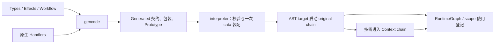

# 主设计：Algebraic Effect Sys in Haskell

更新：2026-11-01。本文统一保存设计原则与当前运行协议，并引用图、资产和 Stream 专题作为完整规范。

运行和书写示例见 [GUIDE](GUIDE.md)，工作约束见 [AGENTS](../AGENTS.md)。

按任务跳转：[核心对象](#model) · [设计原则](#principles) · [生成前类型检查](#beforegen) · [注册](#registration) · [Context](#context) · [workflow](#workflow) · [scope](#scope) · [Error](#error) · [生成](#generation) · [Stream](#stream)。

## 1. 范围与实现状态

本项目用原生 Haskell 表达可分析的 effect 组合：注册声明能力与资产依赖，instance 实现原子操作，workflow 决定完整链如何启动。业务入口固定为：

```haskell
main = interpreter ast effects
```

| 范围 | 状态 | 详细规范 |
| --- | --- | --- |
| Pure、Excu、Scoped、Error、Context；有限 workflow | 当前已实现；Pure 的 IO 边界仍待设计 | [运行语义](LATEST_DESIGN.md#runtime) |
| 统一 Prototype、运行图、静态来源与求值锁 | Stage 1/2 已实现 | [图与来源](EFFECT_GRAPH.md) |
| 资产显式引用与构造器约束 | 当前已实现 | [源码资产](ASSETS.md) |
| Stream、Context 新角色、历史视图与 lifelong | 设计已确定，SDK 实现未开始 | [第 7 章](#stream)及[完整规范](STREAM_LIFELONG.md) |
| EOF、Stream close、嵌套 lifelong、背压等 | 本版延期 | [计划与开放项](TODO.md) |
| Generic Map、独立 Middleware、Hanging、跨 interpreter 存续 | 尚未实现，具体语义需继续收敛 | [计划与开放项](TODO.md) |

实现状态说明代码已接入的范围，不代表全部并发交错或资源逃逸已获证明。过去的编译及 demo 结果概述见 [TODO 的完成摘要](TODO.md#completed)。

<a id="model"></a>
## 2. 核心对象与层次

| 对象 | 表达什么 | 不应承担的职责 |
| --- | --- | --- |
| EffectSpec／typing | 操作类别、类方法入口、能力与资产依赖 | 原子业务方法体 |
| Input | 上游类方法的可用能力，落实为 superclass | 隐式传值或自动补跑上游 |
| asset／契约 | Context 对外发布的具名业务值类型 | 运行时 scope 所有权本身 |
| demands | 消费方需要哪个契约、怎样取值 | 指定随运行时序变化的生产者 |
| Handlers instance | 显式调用上游、执行 IO、解析或取用资产 | 隐藏一套框架外的 effect 组合 |
| original chain | 以原始操作为末端的调用组合 | Context 生产链的 AST 替身 |
| Context chain | 因取值或挂接解析而进入的生产／读取链 | 独立放进 AST 的 Context target |
| AST node／branch | 挂载完整链末端，决定启动与执行控制 | 展开每个 Input 方法或传递业务产物 |
| Prototype | 注册、方法结构、workflow、图及来源等纯事实 | 函数、线程或活资源 |
| RuntimeGraph | 实际活动、执行出身、绑定与资源关联 | 重新推导静态图或完整调用历史 |
| ScopeTree | scope 依赖的共享节点 DAG | workflow 先后顺序或普通 callback 图 |

业务组合分成两个层次：instance 内的类方法引用组合一条链；AST 通过尾部 target 启动这条链，再组合多条链。生成器能提取受支持的引用结构，不解释原子 IO 的业务意图。



首次没有 Handlers 时先生成契约，再编写原生 instance。执行副本与手写模块分别接受检查，不能在同一导入链重复引入相同 instance。

<a id="principles"></a>
## 3. 设计原则

### 3.1 先确定语义，再实现操作

业务组合应能表达为固定结构、引用和契约，并可供第三方工具读写。先明确新功能改变的语义、生产与消费职责、启动和结束边界，再决定注册字段与 Haskell 接口。

原子方法保存无法由框架穷尽解释的业务值操作和外部 IO。生成器提供确定的结构连接；不通过解释任意 IO 或让 LLM 理解完整 runtime 来恢复连接。新增语义尽量收敛在已有层次内，不为实现便利增加用户 key、手写 layer 或独立 impl。

现有源码、demo 和历史编译结果是实现证据；不反过来固定新设计。需求不清或与证据冲突时先查缺口；声明语法变更单独确认，不添加未约定的兼容层或特殊情况。

### 3.2 能力、值和启动分别表达

Input 是 superclass 能力链。下层方法经这条链获得可调用的上游类方法；实际组合写在 instance 方法体中。能力可用不等于必须执行，GHC 不证明方法体调用了全部上游。

Context 表达跨 handler 的业务产值，demands 表达消费契约和访问模式。Input 本身不传值；资产来源与 scope 关闭归属也不是同一个概念。

AST 挂载完整 original chain 的末端，并规定启动和执行控制。Context chain 由取值或挂接解析带起。Node algebra 只 lower 选定末端，SDK 不在方法外排序并补跑 Input 操作。

业务入口保持 `interpreter ast effects`。闭包、Reader、线程和锁属于 SDK 执行装配，不能变成每个业务 handler 的额外装配工作。

<a id="beforegen"></a>
### 3.3 生成前仍是原生 Haskell

手写 Types、Effects、AST／Workflow 和 Handlers 必须能由 GHC／HLS 直接解析、名称解析和类型检查。类方法调用与 ADT 使用保持原生 Haskell；不依赖字符串调用、专用伪语法或生成器修复类型。

“生成前”指生成业务执行副本之前，仍需要已存在且同步的 Generated/Effects 契约。首次先从声明生成接口，再写 Handlers。手写模块与 Generated/Handlers 含同一批 instance，应分别作为检查和运行入口，不能在同一业务导入链重复引入。

生成器可以提取方法关系、生成 MethodGen 和协议包装；运行副本保留原方法体表达式。HLS 类型检查、gencode 结构提取和资产约束检查是不同边界，不能互相替代。

### 3.4 可观察组合与原子方法

effect 调用直接写在注册 instance 方法中。纯结构提取识别支持的显式调用、分支和标准组合，擦除不含 effect 引用的业务值计算；无法提取的 effect 间接组合必须诊断，不能默认为空图。

普通函数是否允许以显式资产引用为边界。注册方法外不能显式书写资产的签名、类型应用、构造、模式匹配或字段操作；局部具名函数同样检查。匿名 lambda 和局部数据计算属于方法体。泛型函数不因接收资产实参而违规，只处理库类型的普通函数允许。

资产集合、递归 ADT、类型别名、构造器生产方归属以及检查例外统一见 [ASSETS](ASSETS.md)。这些约束不追踪泛型值来源，也不证明原子方法的 IO 粒度、业务正确性或所有资源别名。

### 3.5 静态描述与运行状态分开

Prototype 保存结构和事实，不能保存执行函数、类字典或活资源。运行时共享 Prototype，另保存活动 chain、执行出身、资产绑定和 scope 实例。静态位置、运行调用、资产 publication 与资源 owner 必须区分。

ScopeTree 单独构造并保持无环，供依赖清理和 Error 祖先导航使用。AST 先后顺序或 callback 关系不能直接冒充资源父子关系。完整算法归 [EFFECT_GRAPH](EFFECT_GRAPH.md)。

声明的可序列化性不意味着运行中的资源也可以序列化。解释器内部使用函数、闭包和 IO 是正常实现方式，不需要把这些内部对象变成 facade 语法。

### 3.6 自动装配必须有明确依据

规则按“输入前提 → 推导结构 → 运行行为 → 无法判定时的诊断”书写。能力去重不等于实际调用去重，结构可达不等于本次生产或后续持续推进；等待也不能自动解释为失败。

Stream 的目标是让原子方法作者只需理解本方法的输入输出和允许引用的方法。gencode 静态推导 BootPlan，interpreter 执行它；不在运行中猜测业务属于 socket、event 还是 behavior。完整匹配与回调规则作为[主设计第 7 章](LATEST_DESIGN.md#stream)的一部分维护。

### 3.7 约束、保证与开放问题

方法签名、生成期结构检查、运行时协议和外部 IO 保证必须分别说明。绑定稳定性由 ContextStore 及共享 ownership 实现，不能从“描述是纯的”直接推导出重复 IO 幂等或资源安全。

Pure 的 IO 限制、Generic Map、跨独立 interpreter 存续、任意逃逸资源和恢复已展开 continuation 等仍有开放边界；状态见 [TODO](TODO.md)。不以旧候选接口充当已接受的当前 API。

新增功能先给出 facade、生成契约、runtime 责任及 failure／cleanup 边界，再分批实现。当前探索阶段只做必要普通编译，不自行新增测试、负例或额外检查门槛。


<a id="runtime"></a>
## 4. 当前运行协议

本章描述 Stage 1/2 当前协议。Stream 的新增角色、历史视图和持续执行由第 7 章单独规定，目标 API 尚不可用。

<a id="registration"></a>
### 4.1 注册与类方法契约

统一使用 EffectSpec 注册，effect typing 仅有 Pure、Excu、Scoped、Error、Context 五类。旧 Request 类型已并入 Context，request／require 是 Context 内的方法角色，不再计划独立 Request typing。所有方法名绑定放入 typing 对应的 ADT 构造器，不另设顶层 handlers。对外产值的业务转换归 Context，不另设 Map；独立 Read 已取消。

一个 effect 对应一个业务 handler typeclass，可以有多个具名类方法。Scoped 将开启与关闭归入同一个 effect、同一个 typeclass 和同一个用户 instance；Error 将 detect 与 resolve 归入同一个 effect、同一个 typeclass 和同一个用户 instance。Close、Detect、Resolve 不再分别注册为独立 effect 或独立 typing。

| 注册类别 | 同一 typeclass 中的方法职责 | SDK 执行责任 |
| --- | --- | --- |
| Pure | 无对外业务产物的纯计算／检查 | 成功类型固定为 ()，失败使用 SDK 统一协议；语义待定 |
| Excu | 执行声明的操作（原子句柄） | 返回可选信息 Maybe String，只交给挂接的 Context；接入能力并承接失败 |
| Scoped | 开启、关闭（原子句柄），均为 m (Maybe String) | 开启输入 require 同参共享／request fresh；完整链持有实际实例，末个使用者退出且无子 scope 保留时 once-spare |
| Error | detect 定位、resolve 处置，均为 m () | App／IO 沿 ScopeTree 祖先顺序检测；Succ 后调用可选 resolve，保存原始与次生失败 |
| Context | request 产值、require 读取 | 包装 instance 入口；request 成功发布新绑定，require 读取 state、无值时按需求值，失败保留该来源旧值 |

各类别保持统一的 effect 抽象。Input 只组合被注入的操作句柄，不承载业务值；Pure 返回 ()、原子句柄返回可选信息，或 raise，不手写 Succ，也不新增每 effect 的状态表。跨 handler 的业务成功产值统一由 Context 提供，request 只能引用具有生产入口的 Context。Scoped 自身不产值，open／close 在 instance 中通过 demands 声明的 request／require 取值；只有 scope 具有 SDK 管理的存续状态。

#### 注册构造

注册使用普通 ADT 的不同构造器携带各自属性，不因字段不同而引入 type family 或 data family。普通方法名绑定使用 Maybe String，包括 Scoped.open／close 和 Error.detect／resolve；只有 Context.request 使用 requester "方法名" @表示类型，将方法名和表示类型放在一起，契约类型按方法名生成。Nothing 表示未绑定该方法，不把 handler 返回值改成 Maybe。五类方法声明、Context 绑定、scope 状态及 Error 的检测／处置契约保留；App／IO 的 Error 祖先导航接入同一 ScopeTree，本轮自动收尾范围改为有限使用闭包，interpreter 退出仍兜底。

```haskell
-- 普通注册也把主方法名放入 typing
typing = Excu { handler = Just "printPage" }
typing = Pure { handler = Just "checkPage" }
typing = Pure { handler = Nothing } -- 不声明本地调用入口

-- 同一 effect 内的开启与关闭类方法
typing = Scoped
  { open = Just "openReport"
  , close = Just "closeReport"
  }

-- 同一 Error effect 内的两个类方法
typing = Error
  { detect  = Just "detectReport"
  , resolve = Just "resolveReport"
  }

-- 同一 Context effect 内的产值与读取类方法
typing = Context { request = requester "crawlerConfig" @ConfigSettings }
```

typing 保存本 effect 内的方法声明，只有 Context.request 以 requester 声明产物，契约类型按 handler 名生成；消费方 demands 以 requests "契约名"／requires "契约名" 引用契约，契约名即生产方 handler 名首字母大写。Pure／Excu 以 handler 为普通入口，Scoped 以 open 为入口，Context 以 request 为产值入口；require 的类型由同一生产契约推导，缺少该契约时报错。Error 以 handles 声明处理的故障类型，关联 scope 沿 Input／request 推导最近的 Scoped，由 Root 的故障协议调用，不作为普通 Node target。

当前 handler = Nothing 不生成本地业务方法，保留类型契约与 Input 关系；被 target 选择时报没有入口。request 只允许引用具有生产方法的 Context。SDK 不猜测方法名，也不生成默认成功操作。其余多方法类别的缺省处置随协议另定，不能从 Nothing 自动推导出省略清理、吞掉错误或重新产值。

注册中的 EffectTyping 保存方法声明，关联 Typing 只保存 SDK 的 EffectKind 类别标签，不把运行时 String 搬入类型级。五类标签均已加入。顶层 produces 已移除：只有 Context.request 声明业务产物，其他类别的成功值均为 ()。完成边界由 SDK 返回 Succ value 或 Failed failure，不含 Pending。

target 根据 typing 唯一确定调用入口，不要求 class 只有一个方法；request 固定选择 Context 的生产入口。Error 的匹配 scope 沿 Input／request 推导最近的 Scoped，故障路由不通过业务 request 表达；它仍可声明 Context 消费以供 instance 检查或处置。

Error 注册类别与关联 Error e 是不同概念：前者组织检测和处置方法；后者由 SDK 生成 EffectNameError String，类型唯一确定所属 effect。原始 Failure 保存来源、自动分类和消息，传播或次生失败不覆盖原故障；不新增逐方法的 raise 接口，也不要求用户声明错误 ADT。

使用 SDK 的 effect-codegen 输出普通 Haskell 源码，保留 Generated 模块供 review，避免 Template Haskell。生成类用 MINIMAL 和 -Werror=missing-methods 要求实现业务方法。Context.require 由 SDK 默认读取本次调用的成功绑定，不加入 MINIMAL；产值方法必须实现。Nothing 不生成该角色，缺少 open／close 不代表完整 scope 协议。只做必要的普通编译，不增加测试或额外检查门槛。

#### 类方法契约

根 Effect 保留 Require、Produce、Error 关联契约和统一 raise，不新增统一业务 handle。Produce 是 SDK 内部成功类型，默认 ()；只有 Context.request 覆盖为业务 ADT，不含 Output。Input 注入上游方法，instance 直接引用；一个 effect 的多个协议方法仍可有不同签名。

当前普通句柄没有 SDK 注入的位置参数：Pure 返回 m ()，原子句柄（Excu、Scoped.open／close）返回 m (Maybe String)，Context 返回 m (Produce e)。原子句柄的可选信息与成败由 SDK 合成内部 RawOutput，只交给挂在该句柄下（input 指向它）的 Context 解析，没有挂接时丢弃；注入在句柄入口完成，原链不受影响，注入路径同时记入 effect graph 与 ScopeTree。
业务 instance 对载体 m 泛型：instance XInputs m => XEffect m。生成的 XInputs 含自身能力标记（只在载体上成立）、Input 链与 demands 给出的能力及 MonadIO，GHC 因此拒绝越过 Input 链的方法调用。
实例内通过原生 `<-` 取得 Context 业务值，普通 case 只匹配已取得的值；声明 Input 不隐含传值。普通操作仍直接引用 superclass 方法。
Error 同样不增加位置参数；需要原始故障时，通过 SDK 的 caughtFailure 读取当前诊断上下文。

| 类别／方法 | 当前签名或候选 | 状态 |
| --- | --- | --- |
| Pure 主方法 | m () | 成功无业务产物；Pure 的语义与本地 IO 限制另定 |
| Excu 主方法 | m (Maybe String) | 原子句柄；可选信息只交给挂接的 Context |
| Context 生产／读取 | m (Produce e) | 类型为按 handler 名生成的契约；生产成功保存，读取不重复执行 |
| Scoped 开启 | m (Maybe String) | 通过 demands 声明的 request @T／require @T 完成开启；require 参数共享选中的有效实例，request 参数创建新实例；复用实例跳过方法体时没有新输出 |
| Scoped 关闭 | m (Maybe String) | 通过上游 require 读取信息，不重放生产；成功关闭不重复执行；没有挂接点，输出总被丢弃 |
| Error detect | m () | 返回 () 定位成功，raise 表示未定位；SDK 保存 Succ／Failed |
| Error resolve | m () | 未声明 detect 时直接调用，否则仅在 detect 成功后调用；完成结果不覆盖原故障 |

e 在同组方法内指同一个 effect。detect／resolve 与 Excu 使用相同的完成协议，不新增 Bool、Detection 或处置产物 ADT。Context 仍由 instance 显式引用；SDK 不为诊断重新执行生产者。具体生成接口和 instance 写法见 [GUIDE](GUIDE.md)。

资源依赖按真实需要声明，示例不要求所有 Error handler 都使用资源。类约束提供方法可用性，不证明哪一份资源仍可使用；绑定身份、失效、释放状态和收尾次序由 SDK 管理。同一 class 内的方法配对不再插入一个 Close／Detect／Resolve effect，也不构造相互继承的 Input 环。

爬虫目录的 SessionContext 产出原生 CrawlSessionInfo；CrawlSession.open request 会话信息，close require 它，均返回 Nothing。两个 Fetch 是 Excu，直接引用 openCrawlSession，再读取会话信息用于 HTTP User-Agent，在方法体内完成进程 IO 并交出网页正文；两个 Extract Context 以 input 挂在对应 Fetch 下解析正文；打印是 Excu，require 解析出的摘要。无开启输入的会话在使用闭包实际重叠期间共享，最后使用者退出后按 once-spare 自动关闭；后续 Node 可显式开启新一轮，不新增收尾 AST 节点。

#### XInputs 与类型保持

`XInputs m` 包含本 effect 的 `Capability X m`、生成类的 superclass、Input 链全部祖先类、demands 对应的 Provides 与载体能力。能力标记只在本程序载体上有实例；祖先类直接列出，因为经 Effect 类型族 superclass 展开不足以取得全部句柄。

gencode 不要求手写 instance 上下文文本恰为 XInputs。生成执行副本为保留的局部绑定写出由 instance 载体与方法结果决定的完整签名，避免局部泛化改变约束；副本使用 ScopedTypeVariables，手写模块需要 ConstraintKinds。

<a id="calls"></a>
### 4.2 原子定义、注册与实际调用

注册定义契约、Input 能力依赖及生产者引用；instance 在这些可用能力内直接引用上游类方法。生成器读取方法体中的显式 effect 引用形成纯结构副本，不解释任意 Haskell 业务值语义；实际调用仍由原 instance 表达，注册继承不等于自动执行。多份注册的句柄复用语法另行 review。

注册中的参数来源是可序列化的调用描述，不是 env -> value 函数或 IO 闭包。生产者通过注册引用连接；引用者无需复制生产者的定义及其整条上游声明。这份描述不是被重新引入的 impl 层，执行装配仍由 SDK 提供。

需要分别识别以下对象：

- 操作声明，确定契约和可选 handler。
- 业务注册，选择可调用入口并绑定参数来源，供 AST 或其他注册引用。
- 声明中的调用位置，确定输入来源和后续关系。
- 本次执行中的调用，确定输出所属的执行和 scope。
- 输出绑定，确定消费者引用的那份成功值或错误负载。

这些身份由静态引用、执行上下文和闭包局部绑定共同表达：Origin 为 NodeId 加执行序号，ActivationId 识别一次活动调用；无 owner 绑定按 origin 与 Context 来源保存在运行权威表。一份注册可以产生多次调用，require 按原型许可来源共享结果。已开启 scope 的能力复用按 owner 协议处理，不把它误作普通操作结果的自动缓存。

Input 继续表达操作或能力的前提关系。业务值来源单独表达，Context 转换不因为处理某个生产者的输出，就把生产者隐含为能力 Input；前提与取值声明分别核对。

#### Root 的统一入口包装

SDK 的 Effect.handler 是生成区内部入口。Root 转交 Failure 捕获／ErrorStore.handleFailure 协议，其他生成 Effect instance 转交同一 Root。普通方法、Context.request／require（包括默认和覆盖实现）、Scoped.open／close 的生成入口自动包装原协议，业务不写 handler／super 前缀。

根入口不修改业务 caller、不预执行 Context、不另行 boot 或 lower 上游。scope 复用仍经过调用入口，但可以跳过资源方法体。独立 Middleware typing 及装卸策略仍待设计。

<a id="context"></a>
### 4.3 Context、request 与 require

手写 input 只允许 Root 或非 Context effect；Context 经 demands 接入，消费方类只以 Provides 契约作为 superclass。生产者自身仍可有 Input、消费其他 Context，但不能作为 AST node 的末端。原 Input 与生产链的能力同时保留，不重挂来源注册；沿 Input 与 request 收集 scope；require 在 state 无值时可能求值 request（scope 资源除外）。input 指向 Excu 或 Scoped 的 Context 挂在该原子句柄下，由句柄入口注入解析其输出。
爬虫通过 request 连接 URL、抓取、解析与打印，SDK 不预先生产全局 Context。

生产方与消费方分别描述，Context effect 自身也可以消费别的 Context：

```haskell
typing = Context { request = requester "linkedPageSummary" @PageSummary }
demands = [requests "LinkedFetchedPage"]
```

typing 中是本 effect 提供的方法与生产契约；demands 中是本 effect 需要的契约与取值模式，不指名生产方的类或方法。
requests 调用来源的生产入口，requires 读取来源的已有绑定。来源在注册集合中按类型唯一解析，多个生产方即报错。
起始页与链接页两条链的抓取结果表示相同，含义不同；契约类型由各自 handler 名生成，例如 linkedFetchedPage 产出 LinkedFetchedPage，
生成器不会按距离或拓扑替用户选择来源。request 加入解析出的生产者能力，保留原 Input；不再要求生产者的祖先已经包含消费者原 Input。

输入契约与 typing 共同决定方法签名。当前生成器由 demands 形成关联 Require（单输入直接使用该契约，多输入按声明顺序排为元组），
并为每个被需要的契约在本程序载体上生成 Provides instance，按当前消费者分派到解析出的来源方法。
LinkedFetchedPage 包装 FetchedPage，FetchedHTML 是 instance 可匹配的构造器；类型引用不描述某个构造器的子集。
instance 使用原生 Haskell：在 do 中通过 `value <- request @T` 或 `value <- require @T` 取得业务值，普通操作直接引用 superclass 方法。

可确定匹配的单构造器模式可直接写在 `<-` 左侧；多构造器值先绑定再用普通 case 显式处理，失败通过 raise，不新增 MonadFail。SDK 在注册生成的 Context 入口连接 request 生产与 require 读取；生成器解析显式 effect 方法引用以生成纯结构副本；业务执行副本仍只包装入口，不改写原方法体表达式。方法不新增位置参数、Definition、consume 或独立 booter；嵌套取值共享本次 Context 和 scope。未进入的分支不取值，生成源码和创建 Target 不执行业务 IO；不使用 unsafePerformIO／unsafeInterleaveIO。

手写 Handlers 保持原生语法，运行仍编译 Generated/Handlers 的协议包装副本，修改实现后须重新生成。

request 每次重新生产，成功后将同一个值发布为当前 origin 的新绑定并返回；require 先使用当前捕获，再按 protoSources 查本次唯一已发布的可见来源，缺值时在当前 origin 求值一次 request。fallback 成功按普通业务 request 发布，后继可见节点能复用；其条件生产也参与生成期来源唯一性证明。按需求值以（origin，Context 来源）加锁，不合并不同 origin 或显式 request。诊断、自动 cleanup 及 scope 资源 Context 缺值不按需求值；这些阶段的显式生产仅更新局部快照。按需求值触发的 scope 开启参数仍按 require 观察。

刷新失败不覆盖旧绑定，错误原样传播，已完成操作不回滚。普通无 owner 绑定按 origin 保存在一次 interpreter 的权威表，current capture 固定已读取值。scope 例外只覆盖资源 owner 绑定；实例快照里的无 owner 辅助值不能通过资源复用绕过静态来源路由。
SDK 用局部 Reader 记录当前消费者，Provides instance 据此分派到解析出的来源；调用点的 request／require 决定是否重新生产。默认及覆盖的显式读取入口同样检查该来源是否在 demands 中声明，未声明时先报 UndeclaredContextAccess，不读取绑定或执行覆盖方法体。

根入口直接生产。gencode 拒绝未声明的 request @T／require @T，也拒绝直接调用其他 effect 的 Context 方法。
SDK 不预初始化 Context，Input 仍只提供类方法能力；未被引用的上游不执行。scope 多实例绑定见后文；普通 Context 的跨入口读取按原型来源表和实际 origin 确定。

AST 组织链的启动次序，也为跨链来源提供因果可见性。parallel 先抓取并注入解析两页，chained 再打印；打印方法 require 第一阶段发布的摘要，按各自唯一来源读取，不重复抓取。Generic Map 仍待设计。

`Require e` 是 context 中 request／require 声明的 ADT 接收契约；`Produce e` 直接表示成功类型。
业务表示类型在 Types.hs 用原生 data/newtype 单独定义，注册以 requester 的类型参数引用，契约类型按 handler 名生成；Require、Produce 是 Effect 中的关联 type。
只有 Context 的 Produce 是按 handler 名生成的契约类型，其余当前类别默认 ()；Error e 由 SDK 按 effect 名生成，不从产物提取。
它们以原子 effect 为索引，不要求另设契约类，也不因执行载体 m 改变而改变 ADT。

handler 方法是可调用句柄；部分调用产生业务值，但普通句柄组合不要求传递 Produce。
生成器不再定义业务构造器或解释 ADT/Constructor 字段语言，只生成类型关联、方法与装配。
原生 record、嵌套和参数化数据由 Haskell 定义；deriving 也由业务声明选择。
TypeRef 通过 Typeable 识别 SDK 的 Output 构造器以拒绝嵌套完成协议；不解析显示字符串。
其余业务类型保存显示名称，Generated 模块须能解析该类型名；它不保存完整数据定义，也不代表
任意 Haskell 类型结构都能被第三方工具解释或被 Generic Map 自动适配。

业务方法体与上游引用保留在用户 instance 中；爬虫的 FetchPage request 起始 URL，ExtractPage 挂在 FetchPage 下解析其输出，PrintPage require 解析出的摘要；
Program 只登记 FetchPage、PrintPage 等原始句柄末端，摘要在抓取阶段由注入产出，打印阶段的 require 直接读取，不再次抓取。
review 面集中在各 demo，SDK 提供契约、载体、末端登记与 Node lowering；不引入用户另写的 impl 层。

当前完成结果为 Succ value 或 Failed failure。SDK 自动生成 ExtractPageError String 等本地错误、
关联 Error e、raise 实现与 Errors 分类；用户写 raise (ExtractPageError message)。统一 Failure 保存 origin、detail 分类和 message，
不再需要业务错误 ADT、NoError 引用或错误配置。Error 的单射约束保持来源推导；Except 使普通 do 短路，
上游失败原样传播，lower 只解释登记的末端，最终边界只封装一次 Output。
当前不设 Pending；运行图提供活动 chain 的调用身份与关联，逐方法传播历史及通用 IO 异常接入仍未实现。

SDK 不在 handler、request 或 impl 内增加 Succ；生成器拒绝 Context.request 把 Output 声明为产物。
业务 ADT 内部字段保持不透明，不自动展开或改写；原子方法直接返回成功值，编译器核对其与契约一致。

#### 消费声明与读取权限

同一消费者对同一契约的同一取值模式只能声明一次。requests "T" 或 requires "T" 任一声明都允许显式 require @T，读取本身不刷新；显式 request @T 仍需 request 权限。Scoped 至多 request 一个资源 Context。生成器及默认、覆盖读取入口都执行声明检查。

#### 原子输出挂接与失败隔离

Excu.handler／Scoped.open 成功后，SDK 以根调用身份执行挂接的 Context.request。解析器对该原子句柄的直接调用由本次输出回答，不重复执行。注入失败留在注入内部，不进入原链也不触发 Error；后来按需求值失败仍按正常协议传播。

Context 自己主动请求该句柄时直接执行而不再次注入；复用 open、重复 close、诊断与自动收尾不产生新的挂接注入。close 没有挂接点；scope 的资源 Context 不能挂在请求它的 Scoped 下。生成入口通过 atomicHandle／atomicScope 包装，挂接目录为 contextInjections。

这是当前有限执行基线；持续订阅的 parser 故障通知由 [Stream 第 9 节](STREAM_LIFELONG.md#9-故障任务所有权与资源边界)明确扩展，不把此处的失败隔离当作永久等待的依据。

<a id="assembly"></a>
### 4.4 原型与闭包装配

gencode 通过统一 Prototype 保存注册、纯方法结构、workflow、链定义与挂载、EffectGraph、ScopeTree 和静态来源。运行时求值并校验生成原型、注册和源码，在一次 cata 中装配闭包；全部结构通过后才执行业务。

Target 保留未执行末端和内部空状态；Node algebra 负责 lower。Context 的实际生产有独立 RequestBoot 活动记录，继承外层 Execution 和 ScopeUser，不新增提前 cleanup 的边界。

本节引用 [EFFECT_GRAPH.md](EFFECT_GRAPH.md) 作为完整结构规范，包含 NodeId／Origin／ActivationId、绑定出身、来源证明、ScopeTree 构树、源码结构提取、缓存与运行校验。这里不再复制这些算法。

<a id="workflow"></a>
### 4.5 Workflow branch

branch 是 workflow 的模块单位，node 是其内部挂载 effect 链的叶子。每个 branch 在 `Workflow/*.hs` 单独定义，导出有业务含义的名称；`AST.hs` 只组合这些名称。使用非限定 import，组合表达式保持 `chained [parsePages, printPages]`，不写模块前缀。模块名称区别于 chained／parallel 这种控制类别；空闲 scope 由 SDK 自动清理，不为此新增收尾 branch。

SDK 将 node 与 branch 分成两个抽象类型：

```haskell
node :: String -> EffectNode
chained, parallel :: BranchChild child => [child] -> AST
```

BranchChild 为不导出的 SDK 内部约束，只提供 EffectNode 与 AST 两个实例；业务不增加 class、instance 或转换调用。同一列表只能全是 node 或全是 branch，裸 node 不能赋给 AST，原始 AST 构造器与子项转换不公开。单节点模块用 `chained [node "目标"]`，空分支需如 `chained ([] :: [AST])` 的类型标注，仍成功返回空结果。内部递归表示与 algebra 不变，通过 foldAST 使用 cata。

这项类型约束不证明分支来自独立文件，也不禁止内联子分支或直接构造叶模块。独立文件、顶层只引用模块名属于声明格式：正文采用固定 branch 构造、显式列表、node 与直接模块引用，不借任意 lambda／map／条件计算隐藏结构，引用保持有限无环。未来 LSP 保存模块定义、引用和源码位置，并检查该格式；当前执行 AST 不保留源码身份，不新增运行时模块 key。

分文件不建立新 interpreter、注册环境、Context 或 scope。同一模块多次挂载意味着多次执行，不去重调用；原有串行短路、并发汇合与资源共享规则保持。五个 workflow demo 已按此拆分。持续执行的新增边界统一见 [Stream／lifelong](STREAM_LIFELONG.md)，当前 SDK 尚未实现。

#### 有限执行的完成规则

chained 按声明顺序执行，遇失败停止；parallel 并发执行，等待全部分支后汇总，结果按声明顺序排列。有失败时保留声明顺序中首个失败的来源和负载，不按完成先后选择，不自动取消已运行的其他有限分支。已完成 IO 不回滚。

空 branch 成功并返回空结果。AST 只在最终边界封装一次 Output，汇总产物不隐含共享绑定或自动传给后继。节点结果与 Context 发布是不同通道。

#### alternative 的类型边界

当前支持至少两个构造器、每个构造器至多一个字段的和类型；无字段分支包装 ()。每个候选的完整 Input 链恰好依赖同一基础资产的一个分支契约，并覆盖全部构造器。分支契约只能 require；当前构造器不匹配时报 CaseNotSelected，不新增业务状态。

#### alternative 的选择与交接

AST 只列候选，不写条件。gencode 将转折契约、选择读取路径和候选 NodeId 到构造器的关系保存为 WorkflowTree 的 AlternativeProto；分支契约目录保存在 EffectProto。

运行时先 require 转折资产，已有值直接读取，缺值时按需求值一次生产链；再只启动匹配构造器的候选，其他候选不执行。选择阶段捕获的无 owner 绑定经 Handoff 交给候选，两段读取同一快照，其他调用的 request 不改写它。执行只在已装配的闭包间选择，不在链中间重组。

选择读取有独立入口使用登记，以契约名登记末端，NodeId 为 alternative 路径加 [-1]，参与构图与 ScopeTree。validatePrototype 核对转折契约、构造器唯一及覆盖完整；执行 fold 与 --structure 使用同一原型匹配当前 AST，不一致时在业务前拒绝。

<a id="mapping"></a>
### 4.6 业务转换与尚未实现的适配

对外产生业务值的纯转换注册为 Context；不新增 Map typing。当前取值连接要求已声明的契约，Generic Map 尚未接入。

后续结构适配的方向是在 SDK 内部实现固定规则，不增加业务 adapter 配置；支持的类型范围、失败接口及接入仍需确定。状态统一在 [TODO](TODO.md) 跟踪，不把旧候选解释成当前能力。

<a id="scope"></a>
### 4.7 Scope 存续、归属与自动清理

本节记录本轮定案的有限使用闭包协议；运行载体和旧样例按此迁移，不以旧版编译或运行结果宣称本轮已验证。

effect 不配置 dependency。SDK 沿声明收集 Scoped，能力仍由 superclass 注入；require 只在 state 无值时按需求值 request（scope 资源除外），其已有资源前提必须纳入清理依赖。正常业务调用不因继承而补跑 open／close，二者均为 m (Maybe String)，由用户 instance 引用；使用闭包撤销使用后由 SDK 按 once-spare 调用登记的 close，interpreter 退出保留兜底。

同一 interpreter 自动创建一批 ScopeHandler，由所有末端 Target 捕获。每个 Scoped 注册持有实例集合，每份实例独立保存 MVar、生命周期和开启期 Context；实际开启输入的 request／require 模式决定新建还是共享。Main、Effects 和 Handlers 保持原生方法引用，不增加 key、位置参数、用户装配或手写 layer，也没有进程全局单例。运行表可跨 Node 共享，但不预约未来 Node 的活资源。运行表只保留还可能被选中或等待清理的实例：已关闭的实例，以及没有使用者、没有登记清理的非共享实例移出运行表；旧绑定直接持有实例引用，旧引用仍报已关闭；同参共享的失效实例保留，同参 open 继续报原失败，显式 close 后移出。

当前 App／IO 协议采用已有文件链的结构：Scoped 的 requests 资源 demand 引用资源 Context（如 FileResource），该资源 Context 声明消费的上游 Context（如 FileLocation）及其值前提构成开启参数。SDK 生成观察器，在 instance 真正引用这些方法并取得结果时记录原生 ADT 值，按来源、类型和 Eq 比较；参数 ADT 需要 Eq，资源产物不需要 Eq。参数在本次开启中必须保持一致。SDK 不在外部提前执行 Context，不从文件路径字符串、Show 或 Handle 身份猜测参数。

每次显式 open 按原取值声明取得本次参数。作为 scope 匹配参数的开启输入全部实际以 require 取得时，可按 Eq 共享同参活实例，跳过资源获取及 open 的剩余方法体；任何这样的输入实际以 request 取得时，本次 open 默认 fresh，即使值相同也创建新实例，同值旧实例保留并存。这里区分的是开启参数取值，资源 producer 自身用于获取资源的 request 不一律触发 fresh；没有开启输入的 scope 仍可共享。

需要共享时，业务在当前完整链先取得稳定参数，scope 内 require 该绑定。参数生产者自己的 IO 可以运行；open 范围中其他 IO 必须在参数齐备之后，否则报 ScopeInputsMissing。参数变化发生在选定之后则报 ScopeInputAfterOpen。该协议不分析任意 IO 闭包中的隐藏参数，也不将混在参数生产动作里的资源获取自动拆开。本轮协议限定 App／IO 下受管理的有限完整链。

底层 Binding 保存不可变值快照、Execution 出身与共享的 bindingOwnership IORef。每次 request 成功生产新绑定；当前捕获、权威表、scope 快照和 alternative 的 Handoff 共用该绑定的归属单元。require 首先读取本次捕获，不因另一条链发布新值而改变。显式 request 发布并替换当前 origin 的来源绑定。复用实例只接入带 owner 的资源绑定，不把无 owner 辅助快照补入当前调用；后者从按 origin 保存的权威表、按原型许可来源读取。资源关闭后，后续 Node 须显式 open 新一轮；旧资源绑定不自动换 owner。

close 不预先选择 scope，也不预执行 Context。生成包装先进入关闭协议，用户 instance 原有的 require 引用取得 ContextBinding 后，SDK 从该绑定的归属取得生命周期锁，再继续关闭方法体。找不到绑定／归属即失败；关闭期间不能改用另一份归属。重新开启产生新实例，旧绑定仍指向旧的已关闭实例，不会误关新资源。

一个资源绑定只有唯一关闭归属，普通 require 只读取原绑定，不转移资源归属。open 在 scopeCoordinator 内将共享单元从无 owner 首次认领为实际实例，同一实例重复认领幂等。另一个 scope 或同注册的不同实例认领同一绑定时，SDK 在等待实例生命周期锁之前报告 ScopeContextMismatch，不覆盖 owner，也不为冲突实例登记该资源的 cleanup。所有捕获副本观察同一次认领；有效 scope 复用仍传递原绑定。

资源 Context 在 open 外产生无 owner 绑定时，发布／require 返回前登记当前 ScopeUser。认领在同一 scopeCoordinator 内把仍活跃的持有者转入实例使用集合；入口退出在该锁内同时撤销待认领与实例使用，防止漏记使用者或复活已经结束的入口。普通资产不保存待认领使用者；open 内正常生产已有 owner 的路径不变。认领到保存资源绑定保持 masked，资源已被认领后不会因这一交接窗口中断而漏掉 cleanup。

认领保留原来的 publication、值和 origin，不删除来源记录或重新发布；因此 Stage 2 的静态来源事实不因 owner 后补而撤回。资源快照按共享归属单元去重，不合并独立 request。两次 request 即使私下包装同一个底层 Handle，也仍是不同绑定；SDK 不追踪这种物理别名。不新增用户 key、layer、位置参数或借用／转移协议，不改变 handler 写法和 ScopeTree 算法。

跨链第一次 require 尚无本地绑定时，只接受唯一可解析的来源绑定并将其捕获；多份来源且没有明确关联时报 AmbiguousContextBinding。此规则不解决任意历史绑定的用户寻址，不能把同一个无参方法解释成“任选过去第几份值”。同一份已绑定句柄重复 require 稳定，与同一注册结构创建多份调用环境是两回事。

选择共享的并发 open 等待同份实例，等待 opening 的调用也先加入使用，不能因另一调用结束而把其即将使用的资源关闭。request fresh 和不同参数实例各自独立。开启失败／中断后失效，close 失败允许再清理，成功关闭后重复 close 跳过。关闭方法须先引用已有 Context，再做释放 IO；参数／资源生产失败不触发外部补跑。普通下游失败不自动等同于 scope 失效。

现有 demo 按新协议适配：FileDemo 在本链先取稳定路径，校验及开启参数 require 它，省去手写 catch 清理。ScopeInstancesDemo 保留链内 require 同参复用和异参独立，后续 Node 显式开启新一轮；OpenFilesDemo 改为观察当前链及 GC 期间的十个文件，不再要求资源跨空闲 Node 存续。ScopeReuseDemo 的 writer 先 request 参数、scope 内 require；仅实际重叠时共享，不能固定断言整个 parallel 只开一次。它在全部链清理后读取已有日志和追加输出，不 require 旧资源。上述是适配说明，不是新增测试或本轮通过声明。

状态分配不执行业务。原有有限使用闭包以入口使用登记表达：每个 Node lower 的末端完整 chain 建立一份登记；实际 open／require 选中实例时加入使用，同一闭包对同一实例只加入一次。chain 正常返回、失败或取消后，完成相应诊断和 SDK 受控的结果消费，再撤销这次使用。最后使用者离开且子 scope 不再保留它时，once-spare 执行登记的 close。后续尚未开始的 Node 不占用使用名额，资源不会仅因它可能再次使用而留到 interpreter 末尾。

once-spare 当前是 core 固定策略，不提供 policy 配置，也未实现 next-use、超时保留或运行时切换。策略位于 SDK 生命周期协调层，用户原生 open／close 方法的接口独立于这一选择；interpreter 退出时仍执行兜底清理。

生成器登记原有 close 回调，SDK 为实际实例保存清理动作和绑定。清理服从补全后的 scope 依赖，子 scope 仍保留其前提时不得先关闭前提；相等参数的 fresh 实例仍分别持有和释放。显式切换当前绑定不立即关闭同一闭包已经持有的其他实例。公开 interpreter 完成、失败或取消时的全局清理继续作为兜底，不替代闭包退出时的实际回收。

显式 close 已成功的实例跳过，close 失败的实例仍可在退出时清理。某次清理失败不阻止其余实例，原执行失败与各次清理故障均保留；没有原执行失败时，清理失败也不能报告为成功。资源 producer 返回到 SDK 发布绑定采用 masked 交接，open 失败／中断时已经发布的资源仍纳入清理。不为清理重新执行资源生产者，也不因一次 request 改选参数而关闭仍被其他绑定引用的实例。

可开启的 Scoped 须声明 close，缺失时生成阶段报错。退出清理期间拒绝再次 open，避免收尾中新建未纳入本轮结束范围的资源；此时 close 的 Error 路径由自己的生成入口建立，不沿用开启时的下游调用路径。普通收尾失败附在原 Failure.cleanupFailures；原生异常在其余清理尝试完毕后重新抛出，并报告同时发生的清理故障。

重新创建一批运行句柄不共享状态；跨独立 interpreter 的存续不在当前范围。本轮使用计数只覆盖 SDK 管理的完整链及受控结果消费，不追踪任意逸出 Handle。显式 close 只可排除当前闭包自己的使用，仍有其他使用者或未释放子 scope 时以 ScopeInUse 拒绝，不等待当前调用退出；关闭预约期间不接纳新使用。裸 forkIO 自动追踪、任意业务 IO 内尚未发布的部分获取恢复及 Linear 凭证尚未实现。Error 的同实例检测／处置串行化继续沿用原协议，使用与关闭由本轮使用协议协调。

这使“同一绑定保持同一值与资源归属”成为底层表示和 ContextStore 原语的约束，而不是额外 adaptor 的约定。但架构尚未成为能静态证明所有业务公理的系统：生成包装仍提供运行时协议，GHC 不证明 instance 必须使用 DI；App 中的任意 liftIO 不因句柄描述纯而变纯，Pure typing 也尚无完整的 IO 排除约束。Error 使用用户定义的定位条件，不能用它假定外部执行总是确定。

#### 细化契约与节点身份

当前不同细化资源、开启输入及 Scoped 使用不同注册，ScopeTree 因而以 Scoped 注册识别节点；实例再以输入来源、类型与 Eq 值区分。同一 Scoped 服务多种细化资源尚无声明形式。

若以后引入该形式，静态节点、实例表、ownership、close、cleanup 与 Error 导航必须共同改用“Scoped 注册＋细化资源类型”，不能只修改资产命名。

<a id="error"></a>
### 4.8 Error 检测、处置与失败传播

detect 和 resolve 是同一个 Error effect 的两个原子 handler，均以 Maybe String 声明、签名为 m ()；handles 声明处理的故障类型（RaisedBy、ScopeFaultIn、ContextFaultIn）。input 只提供 resolve 调用 scope 方法所需的 superclass 能力；关联 scope 由生成器沿 Input／request 推导最近的 Scoped，至多一个，没有则为不定位实例的全局处置。Error 独立注册，SDK 将回调装配到 Root，不加入正常业务调用链或 AST；注册不提前执行检测。

App／IO 的生成入口沿 Input／request 找最近的 scope，遇到 Scoped 停止，只提供关联种子。Root 捕获传播到生成入口的 Failure 时，合并 scopeTrace、当前 errorPath 和 scopeTargets 中的 scope 名字；生命周期持锁期间只保留种子，退到锁外再由 scopeErrorPath 读取 ScopeHandler.scopeParentNames。这是自动清理也使用的同一棵 ScopeTree 的全部祖先投影：补齐祖先、按父到子的层次去重，同层沿 ScopeHandler 名单顺序，再按 handles 匹配故障，有关联 scope 的回调须位于该路径上；同一 scope 的多个回调沿注册顺序，全局回调随后执行。

完成路径写入 Failure.scopeTrace。候选依赖不是故障归属证明；类型匹配完成粗定位，detect 是可选的值级细化。未注册 detect 时直接调用 resolve；detect 正常完成为 Succ ()，随后调用 resolve；raise 得到 Failed，表示不归此处。无论该项完成或失败，继续处理其余相关 scope。

App／IO 的祖先导航与清理共用生成树，不另存 Error graph，不读取新的 schema 或用户 key，不增加轮询或动态调用 tracing。人工调整生成树父边会同时影响两者；运行校验只检查结构自洽，不证明删边在业务上正确。App／IO 未安装树时仅使用显式种子；Pure 没有 ScopeTree 安装路径，本轮保留旧的完整候选名单协议。

原始故障可通过 `caughtFailure :: m (Maybe (Failure cause))` 读取。SDK 把检测／处置的 Succ 或 Failed 结果保存到原 Failure.errorHandling，保留 origin、detail、message；最终仍传播原失败，不因处置成功把失败业务当作完成。scopeTrace 只保存候选路径，已处理标记防止多层 Root 重复检测，检测和处置的次生失败不递归激活自己。

诊断使用故障时绑定的隔离快照。普通故障按已捕获资源绑定的归属确定实例；open／close 故障优先使用本次生命周期实际选定的实例证据，并隔离其他实例的旧绑定。尚未选定实例时不猜测，也不拿最近一次成功产物代替此次失败资源。SDK 不扫描其他实例、不预执行 Context、不重新 boot；匹配实例的失败绑定可供检测和清理读取，其他绑定保留正常状态检查。

open／close 内部持锁时延后诊断，退到生命周期锁外再执行；同实例用独立 MVar 串行化检测和处置，生命周期锁不跨回调持有。检测与普通业务 IO 不自动互斥，resolve 的显式 close 仍服从使用协议。被业务在锁内 catch 后消化、没有继续传播到安全 Root 边界的故障，不承诺进入自动诊断；任意未转换为 Failure 的 IO 异常也不由此协议捕获。

resolve 可通过 superclass 方法显式清理或重建资源，但 Error 协议不因定位成功自动 invalidate、close、reopen 或重放业务方法。定位成功只表示用户的检测条件成立，实际 scope 状态仍由生命周期操作决定。完整链的 once-spare 及 interpreter 退出兜底独立于是否配置 Error 检测；撤销链的使用须等待本次诊断结束。现有 ExceptT 的失败短路仍保留，不自动恢复已展开的 continuation，也不因业务 Failure 取消其他已经运行的并行分支。

FileDemo 的 FileRecovery 演示：require 原文件句柄，用 hIsClosed 检查意外关闭；已关闭时 detect 返回 ()，否则 raise 表示未定位；resolve 直接引用 closeFileSession。正常路径不注入故障，文件读写仍由原末端执行。

#### 匹配身份与唯一性

handles 只按 Failure 的 origin 与 detail 分类匹配。Context 协议故障，包括 Provides 分派的未声明取值及 CaseNotSelected，origin 使用生产方 effect 注册名，不使用资产契约名。同一 scope 下同一故障类型只允许一个 Error 注册。

<a id="generation"></a>
### 4.9 生成、运行入口与源码同步

[sdk/Framework/SDK.hs](../sdk/Framework/SDK.hs) 保留统一入口；[Effect.hs](../sdk/Framework/Effect.hs) 下分 Contract、Registration、Context 与 Runtime，
分别负责契约、注册解析、存储原语和末端句柄描述／lower。[Recursion.hs](../sdk/Framework/Recursion.hs) 提供纯 Fix／cata／zygo；
[Workflow/AST.hs](../sdk/Framework/Workflow/AST.hs) 保存结构，[Workflow/Execution.hs](../sdk/Framework/Workflow/Execution.hs) 提供执行 algebra 与并发汇合；
[Codegen.hs](../sdk/Framework/Codegen.hs) 负责源码生成。

拆分不改变 boot 范围或 IO 权限，本次文件分离不改变 handler 签名或执行语义。
[Generate.hs](../sdk/Framework/Generate.hs) 提供统一首次生成命令：先加载 Types、Effects 和 AST，用 GHC 9.12 解析器读取 Handlers.hs 的模块、方法边界与显式 effect 引用，生成独立纯结构；再以 GHC 无代码生成模式解析业务名称并检查资产引用，成功后写回 Generated。候选生成模块及手写 Handlers 快照从内存加载，不执行业务。
它们不导入 Generated 或 Handlers；effect 标记与错误类型自动生成，无须用户手写空 data。

首次运行 cabal run effect-codegen -- workflow Crawler，生成接口后填写 handler，再次生成并编译 Main。缺少 Handlers.hs 时先生成空编译模块；有实现后进行完整资产检查，不执行 handler。
业务执行仍编译 Generated/Handlers，SDK 包装方法入口，保留原生取值与业务表达式；纯初始化结构由 Generated.Program 导出，不回写手写源码或新增业务类型类。手写实现变更后须重新生成。
生成的 Handlers 保存解析时的源码指纹；公共 workflow 入口在启动业务前检查当前手写源，缺失或过期则拒绝执行，并核对注册快照；Main 写法不变。

检查从仓库根目录读取源码，--generate 仍可修复过期副本。
已有 Main --generate 仍要求导入链可编译，新增 effect 或缺少生成文件时使用独立 SDK 命令。
[demo/Crawler/Main.hs](../demo/Crawler/Main.hs) 等 demo 演示 IO workflow；
各 demo 的手写入口、注册、handler 与生成模块分别可 review；
仍使用的并发辅助函数已并入当前 SDK。

同次 AST 的运行表保留，本轮迁移到有限使用闭包 once-spare、require 共享／request fresh 及补全后的清理依赖，并由使用协议协调显式关闭。App／IO 的 Root Error 祖先导航使用同一 ScopeTree，实例定位、detect／resolve 与原错传播保留，不自动恢复业务。具体实现与普通编译结果须按本轮代码核对，不由旧样例推断已验证；Stream／lifelong 的目标协议见 [Stream 规范](STREAM_LIFELONG.md)，实现未开始；其他开放项见 [TODO](TODO.md)。


## 5. 静态原型与动态运行

gencode 生成 `generatedPrototype :: SDK.Prototype MethodGen`。它合并 effect 注册、方法结构、WorkflowTree、origin／Context 链定义和挂载、EffectGraph、ScopeTree 与来源表。

`NodeId = [Int]` 是当前 AST 快照的位置；`Origin` 加入本次执行序号；`ActivationId` 标识活动 chain。绑定保存自己的 Execution 出身和共享 ownership，不能用节点位置替代实际实例身份。

运行时先求值并校验原型、注册与源码，再一次 cata 装配当前 AST。RuntimeGraph 复用静态定义并保存活动关系；ScopeTree 单独保持无环。不重跑 handler 建图，也不记录无限方法历史。

结构、来源证明、ScopeTree 算法及缓存细节统一引用 [EFFECT_GRAPH.md](EFFECT_GRAPH.md)。

<a id="documents"></a>
## 6. 文档分工与维护

| 文件 | 唯一职责 |
| --- | --- |
| [README](../README.md) | 项目介绍、快速运行和阅读入口 |
| [AGENTS](../AGENTS.md) | 工作约束、任务路由和源码定位 |
| [GUIDE](GUIDE.md) | 当前可用 API 的书写与操作指南 |
| 本文 | 设计原则、当前协议和新语义的统一入口 |
| [EFFECT_GRAPH](EFFECT_GRAPH.md) | Prototype、来源分析、运行图、ScopeTree 和缓存 |
| [ASSETS](ASSETS.md) | 源码资产集合、显式引用和构造器所有权 |
| [STREAM_LIFELONG](STREAM_LIFELONG.md) | 第 7 章引用的持续执行完整规范，尚未实现 |
| [TODO](TODO.md) | 实施计划、开放项与必要的完成摘要 |

新手从 README 和 GUIDE 进入；维护者或 LLM 从 AGENTS 按任务进入本页章节及相关专题。不要为同一规则另建摘要文件或复制一份规范。

新语义先更新所属规范，GUIDE 随实际可用接口更新；明确区分当前实现、已确定但未实现、待设计和历史证据。冲突按用户已确认的语义核对，不能靠文件日期或旧 demo 的一次成功裁决。

文档保持 docs/*.md 平铺，与当前 Cabal 源码包清单一致。

<a id="stream"></a>
## 7. Stream 与 lifelong：已确定的下一阶段

**[STREAM_LIFELONG.md](STREAM_LIFELONG.md)是本章的完整规范，通过引用并入主设计。** 其中目标 API 尚未实现；本章不重新维护另一份匹配表或调度规则。

增加的语义集中在三处：

1. Stream effect 提供持续来源；Context 的 stream 角色逐条解析。普通 Context 也可按 request 序列供给。生产方式由明确结构匹配，不靠识别方法体里是 socket、event 还是 behavior。
2. `streams "T"` 声明持续消费。handler 用 `require @T` 读取本次交付固定的历史视图；读取本身不领取下一个增量。
3. lifelong 按资产发布和前驱完成的就绪条件回调 boot original-chain target。每次 target 调用仍有限完成，持续订阅由控制流管理。

| 需要确认或实现的主题 | 本章所属规范 |
| --- | --- |
| 资产命名、Context 角色互斥、beforegen 类型 | [Stream 第 3 节](STREAM_LIFELONG.md#3-资产方法与-beforegen) |
| Receive／ObserveOrigin／RepeatRequest 的推导 | [Stream 第 4 节](STREAM_LIFELONG.md#4-自动推导-bootplan) |
| 原始链消费摘要与合法性 | [Stream 第 5 节](STREAM_LIFELONG.md#5-静态消费摘要与合法性) |
| 并发单元、回调 boot 与有限完成边界 | [Stream 第 6 节](STREAM_LIFELONG.md#6-lifelong-的回调-boot-与控制流) |
| 会话、完整历史、独立游标与固定捕获 | [Stream 第 7 节](STREAM_LIFELONG.md#7-会话历史捕获和运行身份) |
| 失败、任务所有权与 close 延期边界 | [Stream 第 9 节](STREAM_LIFELONG.md#9-故障任务所有权与资源边界) |

这次扩展继续使用 Prototype、RuntimeGraph 和独立 ScopeTree。业务方法不新增游标、yield、调度器或无限递归写法。来源和启动责任不明确时生成诊断；可达性本身不能证明已有驱动。

## 8. 计划与证据

实施批次、开放问题和必要验证摘要统一保存在 [TODO](TODO.md)。推进 Stage 3 时同步更新本文状态、所属规范与实际接口指南，不能把计划写成已实现能力。验证摘要保留日期和未覆盖范围，不代表本次重新执行。
